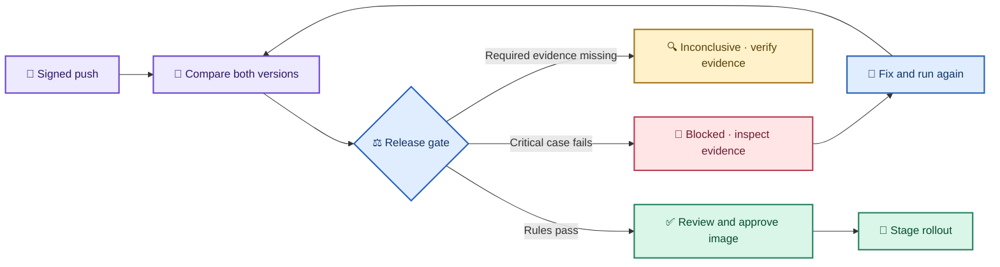

# ReleaseTrace

**Catch AI regressions before they reach users.** ReleaseTrace asks the current and proposed versions of an AI application the same questions, blocks releases that fail critical checks, and shows reviewers the evidence behind the decision.

[Try the demo](#run-the-local-demo) · [See what happens](#follow-a-release) · [Review the results](#verification-and-rollout-evidence) · [System architecture](docs/ARCHITECTURE.md) · [File and folder diagrams](docs/CODE_MAP.md)

> **The demo in one line:** The proposed version answers four out of five questions correctly. Its fifth answer cites an outdated account-closure policy, so ReleaseTrace blocks the release.

## Follow a release



| In the dashboard | What it means |
| --- | --- |
| **Stable** and **Candidate** | The reference version and the version being proposed for release. |
| **Case evidence** | The test question, the expected source, and the source each version actually cited. |
| **Release decision** | The release rules produce a verdict of passed, blocked, or inconclusive. One failed critical case can block the release even when the overall score is high. |
| **Investigation** | On supported demo cases, a maintainer can rerun one change to see whether it restores the expected source. The original decision stays on record. |
| **Approval** | An authorized reviewer records a decision against the candidate's exact container image digest. An operator can then submit a staged rollout. |

## Run the local demo

**You’ll need Docker with Compose and a running Docker engine.** Run these commands from the repository root. The demo uses sample policy data and local-only access tokens.

```bash
docker compose up --build --wait --wait-timeout 90
docker compose exec -T api python -m service.seed_demo
```

1. Open the [dashboard](http://localhost:3000) and sign in with `demo-maintainer-token`.
2. Select **Review latest run**. The decision explains why the release was blocked.
3. Select **Compare case evidence**, then **Failed cases**. Compare the old and current account-closure sources.
4. Select **Investigate** on the failed case and refresh the investigation once the worker finishes. The controlled rerun restores the correct source.

<details>
<summary><strong>Try approving a corrected candidate</strong></summary>

```bash
docker compose -f compose.yaml -f compose.approval.yaml up --build --wait --wait-timeout 90
docker compose -f compose.yaml -f compose.approval.yaml exec -T api python -m service.seed_demo --targets demo/passing_build_targets.json
```

Sign out, sign in with `demo-approver-token`, and open the run for the commit beginning `3333333`. When the decision shows **Passed**, select **Approve candidate**. The saved decision shows the reviewer and timestamp. Expand **Evaluation provenance** to see the evaluated image digest. Use `demo-viewer-token` for read-only access.

</details>

<details>
<summary><strong>Verify or stop the local stack</strong></summary>

Run the first smoke check with the base stack active and the second after enabling the approval overlay. The approval smoke check can record the approval itself.

```bash
docker compose exec -T api python -m service.smoke_demo
docker compose -f compose.yaml -f compose.approval.yaml exec -T api python -m service.smoke_approval
```

Stop the stack with `docker compose down` or, if you enabled approvals, `docker compose -f compose.yaml -f compose.approval.yaml down`. The named PostgreSQL volume retains the runs. Both services bind to loopback.

</details>

### Run without Docker

With Python 3.10 or later, run the fixture and gate without credentials:

```bash
python demo/release_trace_demo.py
python demo/release_gate.py
python -m unittest discover -s demo -v
```

For a real HTTP citation example, the companion **Runbook RAG** application answers from versioned runbooks. CI builds three revisions from distinct commits and evaluates them by OCI digest. [Runbook benchmark and reproduction steps](docs/PILOT.md#evaluate-runbook-rag)

## Verification and rollout evidence

| What was tested | What the evidence shows |
| --- | --- |
| **Runbook RAG gate** | Stable cited the current runbook, a stale candidate was blocked, and a corrected candidate passed a fresh run. All three abstained when evidence was missing. [CI evidence](https://github.com/sujayv26/release-trace/actions/runs/44674214837/artifacts/14601820590) |
| **Retrieval benchmark** | Hybrid retrieval found the right citation on **9 of 9** answerable questions versus **6 of 9** for BM25. Both abstained on **4 of 4** unanswerable questions in the local synthetic holdout. [Benchmark and limitations](docs/PILOT.md#evaluate-runbook-rag) |
| **Access and recovery** | The isolated PostgreSQL pilot exercised project isolation, key revocation, zero requests to an unapproved URL, stalled-worker detection, and restoration of run, approval, and access-audit records. [Pilot CI](https://github.com/sujayv26/release-trace/actions/runs/44674214837/job/136082056654) |
| **Approved image and signed provenance** | CI verified that both stable Kubernetes Pods ran the approved image digest. The signed provenance rehearsal rejected mismatched commit and image identities. [Digest continuity](https://github.com/sujayv26/release-trace/actions/runs/44301532495) · [Signed provenance](https://github.com/sujayv26/release-trace/actions/runs/44348673888) |
| **Canary rollback** | In one isolated kind drill, Argo detected an HTTP 503 in **5.30 s**. The stable service was verified **0.22 s** after detection. [Drill and timing artifact](https://github.com/sujayv26/release-trace/actions/runs/44293631233) |

**Deployment status:** The local demo and CI rehearsals are runnable. Hosted pilot verification and live GitHub App delivery remain open. [Pilot runbook](docs/PILOT.md)

## Engineering and ownership

I built ReleaseTrace end to end, including the evaluation rules, reviewer experience, signed intake, persistence, investigation, and rollout rehearsal.

| Area | Built with | What to look for |
| --- | --- | --- |
| **Product and interface** | Next.js, React, TypeScript | Searchable release history, role-scoped project navigation, and side-by-side evidence. [Dashboard](dashboard/app) |
| **Backend and reliability** | FastAPI, PostgreSQL, Alembic, Temporal | Signed and deduplicated webhooks, durable evaluation results, and worker replacement after a committed run. [API](service/api.py) · [Recovery test](service/test_temporal_worker.py) |
| **AI evaluation** | Deterministic gate, LangGraph, SQLite FTS5 | Critical-case rules, citation validation, bounded investigation, and an offline retrieval benchmark. [Evaluator](service/evaluate_builds.py) · [Runbook RAG](runbook_rag) |
| **Delivery and access** | GitHub Apps, Docker, OCI digests, Argo Rollouts | Check publication, audited project roles, and an approval attached to the exact evaluated image. [Architecture](docs/ARCHITECTURE.md) · [CI workflow](.github/workflows/ci.yml) |

### Trace a release in the source

The [system architecture](docs/ARCHITECTURE.md#system-design) shows what runs
together and where trust boundaries sit. The [file and folder diagrams](docs/CODE_MAP.md)
zoom in from the dashboard and API to individual files, migrations, tests, and
deployment configuration.

| If you want to understand… | Start here |
| --- | --- |
| 🔐 **Who can see or approve a run** | The dashboard exchanges a reviewer key for a one-hour session. The API resolves current project grants on protected requests. [Dashboard session](dashboard/lib/session.ts) · [API authentication](service/authentication.py) |
| ⚖️ **Why a candidate was blocked** | The evaluator compares the citation returned by each pinned build with the expected citation for the same case. The shared gate applies the critical-case and scoring rules. [HTTP evaluator](service/evaluate_builds.py) · [Gate](demo/release_gate.py) |
| 🔎 **Where the cited answer comes from** | Runbook RAG retrieves an excerpt from versioned documents or abstains when evidence is insufficient. The Investigator separately rehearses a bounded change for supported synthetic failures. [Retrieval](runbook_rag/ranking.py) · [Investigation graph](service/investigation_graph.py) |
| 🗄️ **How work survives interruption** | PostgreSQL holds the queued inputs and saved evidence. The worker commits the evaluation claim and report together, so an interrupted run can be retried. [Store](service/store.py) · [Recovery drill](demo/pilot_rehearsal.py) |
| 📨 **How a result gets back to GitHub** | The publisher ties the Check to the evaluated commit and reconciles an existing Check before creating one. [Check queue](service/check_queue.py) · [Check publisher](service/github_check.py) |
| 🚀 **What actually gets deployed** | The promotion CLI checks the approved image digest and verifies provenance when required. Argo owns the canary outcome. [Promotion CLI](staging/promote_approved.py) · [Rollout rehearsal](.github/workflows/staging.yml) |

## Documentation

- [Operations](docs/OPERATIONS.md) for service configuration, GitHub Checks, testing, and staged rollouts.
- [Pilot runbook](docs/PILOT.md) for project onboarding, hosting preparation, benchmark results, and restore drills.
- [Security and access](docs/SECURITY.md) for individual reviewer keys, browser sessions, and project isolation.
- [Architecture](docs/ARCHITECTURE.md) and [code map](docs/CODE_MAP.md) for system responsibilities and file-level diagrams.
- [API](docs/API.md) and [database](docs/DATABASE.md) for access rules and stored evidence.
- [Investigator guide](docs/ReleaseTrace-Agent-Build-Guide.md) for controlled experiments and benchmark results.
- [Product requirements](docs/PRD.md), [implementation plan](docs/IMPLEMENTATION_PLAN.md), and [contributor instructions](AGENTS.md).
