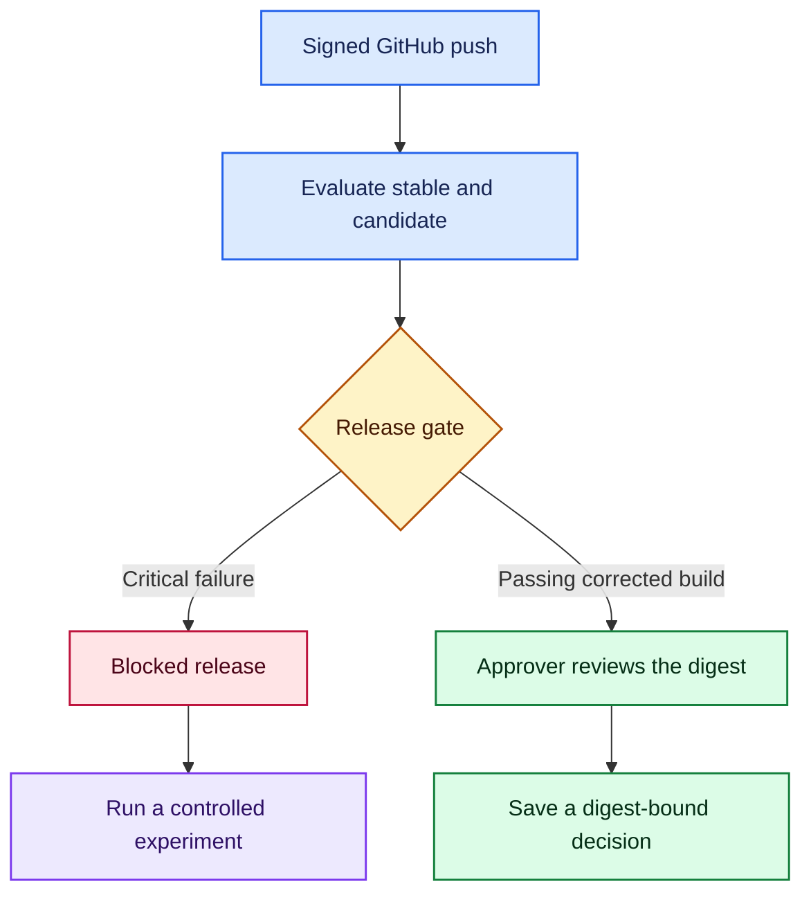

# ReleaseTrace

ReleaseTrace helps teams review AI application releases. It runs the same policy cases against stable and candidate builds, blocks critical regressions, and gives reviewers evidence to investigate failures and approve the exact build they evaluated.



<details>
<summary>Why does the first release stay blocked after the rerun succeeds?</summary>

The rerun restores the stable retrieval setting for one case and explains the regression. The original evaluation still records the failed critical case. The corrected build gets its own evaluation and decision.

</details>

## Run the local demo

You need Docker and Compose v2. Run the commands from the repository root. The walkthrough uses synthetic support policies and local demo credentials.

### 1. Reproduce and investigate a blocked release

```bash
docker compose up --build --wait --wait-timeout 90
docker compose exec -T api python -m service.seed_demo
```

Open the [dashboard](http://localhost:3000) and sign in with `demo-maintainer-token`. Open the blocked run, choose **Failed cases**, and click **Investigate** on the account-closure case. Refresh the report once the worker finishes.

The candidate passes four of five cases and cites an old policy on the critical account-closure case. The controlled rerun restores the stable retrieval setting and returns the current citation. The release gate stays blocked.

### 2. Evaluate and approve a corrected build

```bash
docker compose -f compose.yaml -f compose.approval.yaml up --build --wait --wait-timeout 90
docker compose -f compose.yaml -f compose.approval.yaml exec -T api python -m service.seed_demo --targets demo/passing_build_targets.json
```

Sign in with `demo-approver-token` and open the commit starting with `3333333`. Once the gate passes, select **Approve candidate**. The run shows the reviewer and timestamp. Its provenance includes the evaluated demo digest. Use `demo-viewer-token` to review the history and saved decisions with read-only access.

Both runs share the same PostgreSQL database. The seed commands are safe to repeat. The dashboard and API bind to loopback, and the supplied tokens are for local use.

### 3. Verify the flow

Run the fixture smoke while the base configuration is active. Run the approval smoke after enabling the approval overlay. The approval smoke records the decision itself, so click **Approve candidate** first for a manual walkthrough.

```bash
# Base configuration
docker compose exec -T api python -m service.smoke_demo

# Approval configuration
docker compose -f compose.yaml -f compose.approval.yaml exec -T api python -m service.smoke_approval
```

Stop the base stack with `docker compose down`. If you enabled approvals, use `docker compose -f compose.yaml -f compose.approval.yaml down`. The named database volume retains the runs.

## Verification and rollout evidence

- **Release review.** CI passed the signed webhook and duplicate-delivery checks, blocked release, controlled rerun, passing evaluation, and protected approval. It also passed PostgreSQL integration, dashboard build, and the Temporal worker-replacement test. [ReleaseTrace CI](https://github.com/sujayv26/release-trace/actions/runs/44294539695)
- **Canary drill.** In one isolated kind run, Argo promoted the healthy revision in **6.69 s**. It detected HTTP 503 from the unhealthy canary in **5.30 s** and verified the stable service **0.22 s** after detection. The workflow publishes the JSON evidence as an artifact. [Canary run and artifact](https://github.com/sujayv26/release-trace/actions/runs/44293631233)
- **Investigator holdout.** Both offline methods diagnosed three of four diagnosable cases. The rule made one incorrect diagnosis across six cases. The scripted Investigator made zero and used four controlled reruns. [Benchmark and error analysis](docs/ReleaseTrace-Agent-Build-Guide.md#5-benchmark-the-contribution)

The approval walkthrough uses synthetic build identities. The canary drill runs separately in kind. Connecting saved approvals to deployment of the exact OCI image, verifying live GitHub App delivery, and measuring hosted model results are open milestones.

See the [system design and delivery lifecycle](docs/ARCHITECTURE.md) for the service boundaries, or expand the [canary decision flow](docs/OPERATIONS.md#run-the-staging-canary-drill) to see what the drill checks.

## Run without Docker

With Python 3.10 or later, run the key-free fixture, gate, and demo unit tests:

```bash
python demo/release_trace_demo.py
python demo/release_gate.py
python -m unittest discover -s demo -v
```

Install `service/requirements.txt` to run the [service tests and offline Investigator benchmark](docs/OPERATIONS.md#local-verification).

## Documentation

| Guide | Contents |
|---|---|
| [Operations](docs/OPERATIONS.md) | Run individual processes, connect real build endpoints, configure GitHub Checks, run Temporal and the canary drill |
| [Architecture](docs/ARCHITECTURE.md) | Service boundaries, data flow, and current deployment model |
| [API](docs/API.md) and [database](docs/DATABASE.md) | Endpoints, authorization, migrations, and persisted evidence |
| [Investigator](docs/ReleaseTrace-Agent-Build-Guide.md) | Controlled experiments, holdout results, and optional hosted benchmark |
| [Implementation plan](docs/IMPLEMENTATION_PLAN.md) and [product requirements](docs/PRD.md) | Verified milestones, open integrations, and product scope |
| [Dashboard design](docs/DESIGN.md) and [contributing](AGENTS.md) | Reviewer experience and development workflow |
