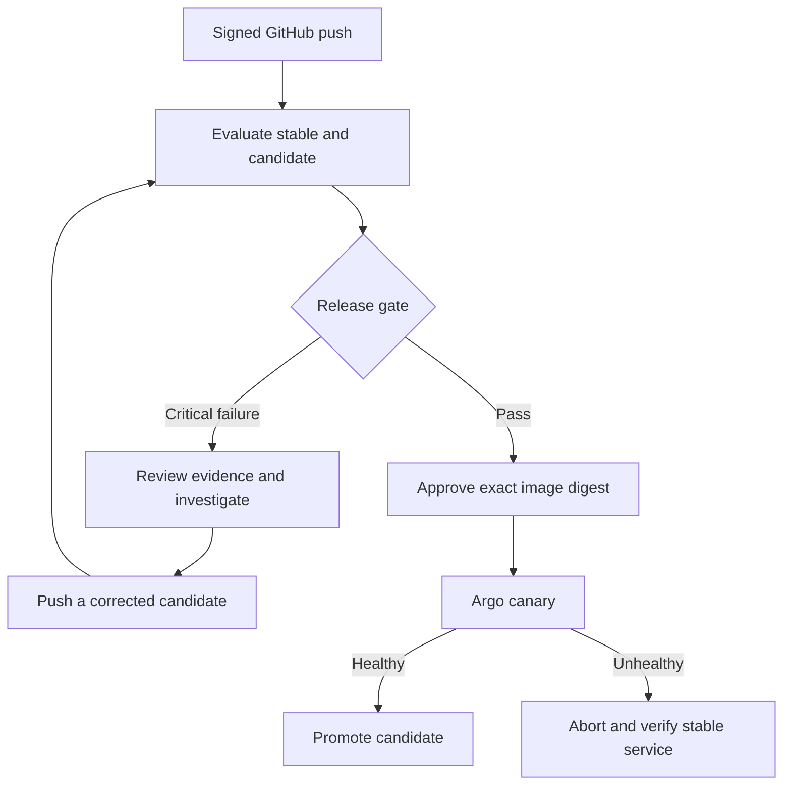

# ReleaseTrace

**Release verification for AI applications, from a signed GitHub push to a canary rollout.** ReleaseTrace compares the stable and candidate builds on the same tests, explains why a critical regression blocked a release, and ties approval to the exact image that passed.

[What I built](#what-i-built) · [See the workflow](#follow-a-release) · [Verification evidence](#verification-and-rollout-evidence) · [Technical skills](#technical-skills-and-stack) · [Run the demo](#run-the-local-demo)

## What I built

I designed and implemented ReleaseTrace end to end, including the evaluation policy, FastAPI backend, PostgreSQL persistence, reviewer dashboard, LangGraph investigation, GitHub integration, and CI and rollout workflows.

| Engineering decision | Why it matters |
|---|---|
| **Gate critical cases individually** | A candidate can score 80% and still give users an outdated account-closure policy. That critical failure blocks the release. |
| **Investigate with a controlled rerun** | The Investigator restores one retrieval setting and records whether the correct citation returns. A corrected build goes through a fresh evaluation. |
| **Approve the tested artifact** | Approval records the candidate’s OCI image digest. The rollout rehearsal verifies that both stable Pods run that same digest after promotion. |
| **Make retries safe** | GitHub redelivery reuses the queued delivery. The Temporal recovery test verifies that a worker replacement preserves a committed evaluation report. |

## Follow a release



<details>
<summary><strong>What happens when the candidate scores 80%?</strong></summary>

The stable build answers all five demo questions correctly. The candidate answers four correctly and cites an outdated policy on the critical account-closure case. A maintainer opens the failed case, compares the two answers, and runs the investigation. The current citation returns when the stable retrieval setting is restored. The original run remains blocked and the corrected build gets its own verdict.

</details>

<details>
<summary><strong>How is it built?</strong></summary>

FastAPI verifies signed deliveries and persists work in PostgreSQL. A background worker evaluates both versions and applies the release policy. Next.js renders the evidence and approval UI. LangGraph runs the bounded investigation, and the GitHub publisher reports the verdict on the evaluated commit. An operator submits the approved digest to Argo Rollouts for canary analysis.

The release page shows the latest observed promotion or abort beside the saved approval, including the digest of the stable revision. [Record a rollout observation](docs/OPERATIONS.md#submit-an-approved-image-to-argo-rollouts)

[System architecture and delivery flow](docs/ARCHITECTURE.md)

</details>

## Verification and rollout evidence

| What was verified | Result | Evidence |
|---|---|---|
| **Release review and worker recovery** | CI exercised signed input, duplicate delivery, a blocked release, a controlled rerun, a protected approval, and Temporal worker replacement. | [CI run](https://github.com/sujayv26/release-trace/actions/runs/44294539695) |
| **Approved artifact promoted** | CI evaluated two registry images and verified that both stable Pods ran the approved OCI digest after promotion. | [Rollout run](https://github.com/sujayv26/release-trace/actions/runs/44301532495) |
| **Unhealthy canary aborted** | In one isolated kind drill, Argo detected HTTP 503 after **5.30 s**. The stable service was verified **0.22 s** after detection. The healthy revision promoted in **6.69 s**. | [Canary run and JSON artifact](https://github.com/sujayv26/release-trace/actions/runs/44293631233) |
| **Investigator benchmarked** | Both offline methods correctly diagnosed **3 of 4 diagnosable cases**. Across six total cases, the rule made one incorrect diagnosis and the scripted Investigator made zero, using four reruns. | [Benchmark and error analysis](docs/ReleaseTrace-Agent-Build-Guide.md#5-benchmark-the-contribution) |

The Compose demo uses one synthetic project. Managed mode supports separate organizations and projects, individual reviewer keys, per-project roles, and versioned evaluation suites and gate policies. The CI rollout rehearsal uses real registry images and a locally signed delivery. Live GitHub App delivery and hosted-model measurements are open. [Managed project setup](docs/OPERATIONS.md#configure-managed-projects-and-reviewer-accounts) · [Project evaluation setup](docs/OPERATIONS.md#define-a-projects-evaluation) · [Implementation status](docs/IMPLEMENTATION_PLAN.md)

## Technical skills and stack

| Skill area | Technologies | What I built |
|---|---|---|
| **Full-stack web development** | TypeScript, React, Next.js App Router, CSS | A server-rendered dashboard for comparing release runs, reviewing investigation evidence, and approving a candidate by image digest. [Dashboard source](dashboard/app) |
| **Backend APIs and security** | Python, FastAPI, Pydantic, Uvicorn, HMAC-SHA256 | Typed HTTP endpoints, signed GitHub webhook verification, delivery deduplication, and repository-scoped viewer, maintainer, and approver access. [API implementation](service/api.py) |
| **Database design and worker reliability** | PostgreSQL, SQLite, SQLAlchemy, Alembic, Temporal | A persistent queue and migration history for release evidence, plus a worker-replacement test that checks a retry preserves the committed report. [Database design](docs/DATABASE.md) · [Recovery test](service/test_temporal_worker.py) |
| **AI evaluation and agent workflows** | LangGraph, HTTPX, OpenAI API adapter | A deterministic release gate, an Investigator bounded to one controlled rerun, and a holdout benchmark that compares diagnosis accuracy and abstentions. The hosted model adapter is available as an optional benchmark path. [Evaluator](service/evaluate_builds.py) · [Investigator benchmark](service/investigation_benchmark.py) |
| **GitHub integrations** | GitHub Apps, GitHub Checks API, PyJWT | Check preview and publishing logic that ties results to the evaluated commit, with retries and reconciliation when a publish response is lost. [Check publisher](service/check_queue.py) |
| **Containerization and progressive delivery** | Docker, Docker Compose, OCI image digests, Kubernetes, kind, Argo Rollouts | A local demo stack and an isolated staging workflow that verifies the approved digest is the one running after promotion. A separate drill exercises automatic canary abort. [Staging workflow](.github/workflows/staging.yml) |
| **Automated testing and CI** | GitHub Actions, Python `unittest`, HTTPX test transports | Unit, database integration, worker recovery, and Compose smoke coverage for the release review path, alongside a production dashboard build. [CI workflow](.github/workflows/ci.yml) |

## Run the local demo

You need Docker and Compose v2. Run the commands from the repository root. The walkthrough uses synthetic support policies and local demo credentials.

### 1. Reproduce and investigate a blocked release

```bash
docker compose up --build --wait --wait-timeout 90
docker compose exec -T api python -m service.seed_demo
```

Open the [dashboard](http://localhost:3000) and sign in with `demo-maintainer-token`. Open the blocked run, choose **Failed cases**, and click **Investigate** on the account-closure case. Refresh the report once the worker finishes.

The candidate passes four of five cases and cites an old policy on the critical account-closure case. The controlled rerun restores the stable retrieval setting and returns the current citation. The release gate stays blocked.

### 2. Evaluate and approve a corrected build

```bash
docker compose -f compose.yaml -f compose.approval.yaml up --build --wait --wait-timeout 90
docker compose -f compose.yaml -f compose.approval.yaml exec -T api python -m service.seed_demo --targets demo/passing_build_targets.json
```

Sign in with `demo-approver-token` and open the commit starting with `3333333`. Once the gate passes, select **Approve candidate**. The run shows the reviewer and timestamp. Its provenance includes the evaluated demo digest. Use `demo-viewer-token` to review the history and saved decisions with read-only access.

Both runs share the same PostgreSQL database. The seed commands are safe to repeat. The dashboard and API bind to loopback, and the supplied tokens are for local use.

### 3. Verify the flow

Run the fixture smoke while the base configuration is active. Run the approval smoke after enabling the approval overlay. The approval smoke records the decision itself, so click **Approve candidate** first for a manual walkthrough.

```bash
# Base configuration
docker compose exec -T api python -m service.smoke_demo

# Approval configuration
docker compose -f compose.yaml -f compose.approval.yaml exec -T api python -m service.smoke_approval
```

Stop the base stack with `docker compose down`. If you enabled approvals, use `docker compose -f compose.yaml -f compose.approval.yaml down`. The named database volume retains the runs.

## Run without Docker

With Python 3.10 or later, run the key-free fixture, gate, and demo unit tests:

```bash
python demo/release_trace_demo.py
python demo/release_gate.py
python -m unittest discover -s demo -v
```

Install `service/requirements.txt` to run the [service tests and offline Investigator benchmark](docs/OPERATIONS.md#local-verification).

## Documentation

| Guide | Contents |
|---|---|
| [Operations](docs/OPERATIONS.md) | Run individual processes, connect real build endpoints, configure GitHub Checks, run Temporal and the canary drill |
| [Architecture](docs/ARCHITECTURE.md) | Service boundaries, data flow, and current deployment model |
| [API](docs/API.md) and [database](docs/DATABASE.md) | Endpoints, authorization, migrations, and persisted evidence |
| [Investigator](docs/ReleaseTrace-Agent-Build-Guide.md) | Controlled experiments, holdout results, and optional hosted benchmark |
| [Implementation plan](docs/IMPLEMENTATION_PLAN.md) and [product requirements](docs/PRD.md) | Verified milestones, open integrations, and product scope |
| [Dashboard design](docs/DESIGN.md) and [contributing](AGENTS.md) | Reviewer experience and development workflow |
