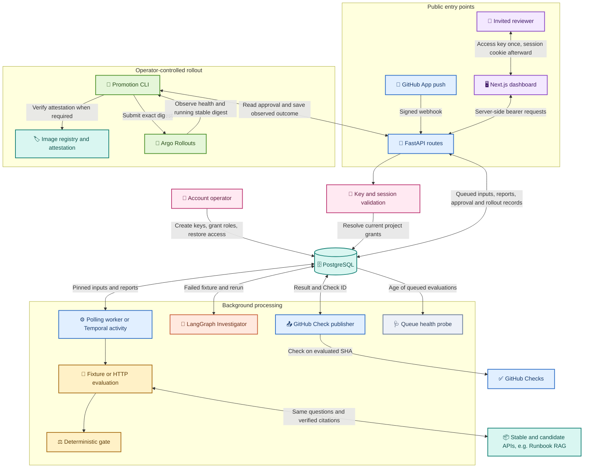
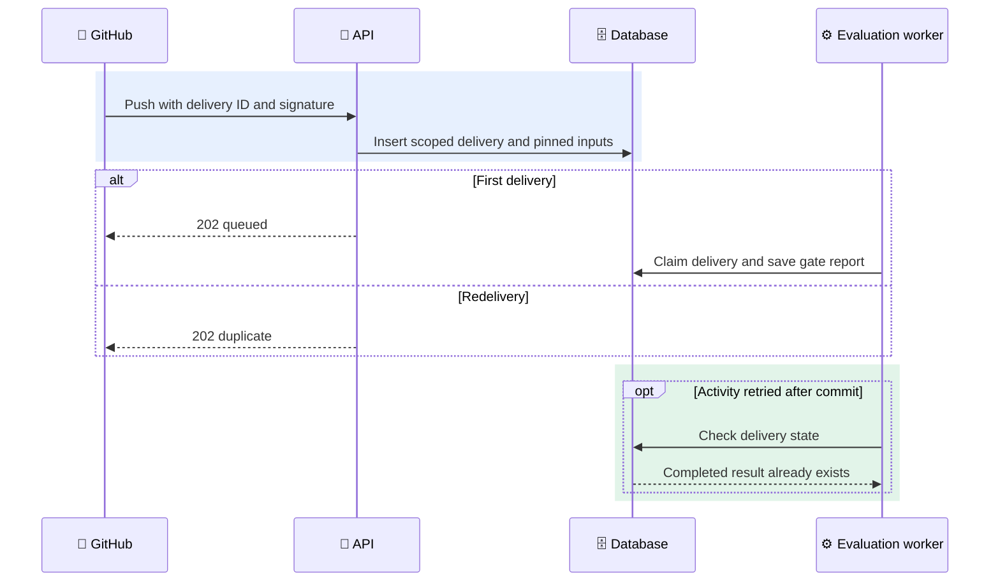

# Architecture

ReleaseTrace supports an operator-managed directory of GitHub repositories and installations. Reviewer accounts get roles per project, and release evidence is scoped to that repository and installation. The Compose demo uses shared role tokens for one project. Compose runs PostgreSQL, applies Alembic migrations, and starts FastAPI, the Python worker, and the Next.js dashboard. SQLite supports local service development.

## Repository map

Use the [file and folder flowcharts](CODE_MAP.md) to see how the individual
source files fit into each subsystem.

| Path | Responsibility |
| --- | --- |
| `dashboard/app/actions.ts`, `dashboard/app/runs` | Sign-in and sign-out actions, release review pages, and approval and investigation actions |
| `dashboard/lib/session.ts` | Sign-in, browser cookie, and logout |
| `dashboard/lib/releases.ts` | Server-to-server release API client and response types |
| `service/api.py` | HTTP routes, project-scoped evidence queries, and digest-bound approval checks |
| `service/authentication.py`, `service/accounts.py`, `service/projects.py` | Key and session validation, current grant resolution, credential administration, and project directory validation |
| `service/store.py`, `service/migrations` | Database access, persistent state, and schema changes |
| `dashboard/app/access`, `service/access_requests.py` | Reviewer access requests, operator decisions and transactional viewer grants |
| `service/worker.py`, `service/temporal_worker.py` | Background evaluation, investigation, and Check publication |
| `service/evaluate_builds.py`, `service/evaluation_config.py` | Application evaluation and versioned project suites |
| `service/investigation_graph.py`, `service/github_check.py` | Controlled diagnostic reruns and formatting GitHub Checks |
| `runbook_rag` | Companion application tested by ReleaseTrace |
| `demo/pilot_rehearsal.py`, `demo/pilot_browser.py` | Isolated PostgreSQL backup and restore, operator workflow, and production dashboard session checks |
| `staging`, `.github/workflows` | Rollout tooling and CI |

The dashboard owns browser cookies. The API owns session validation and
project authorization. The worker owns outbound evaluation credentials, and
the rollout operator owns Kubernetes access. See [security and access](SECURITY.md)
for the credential lifecycle and deployment checks.

## System design

Read the chart by responsibility. **Purple** marks the reviewer experience,
**rose** marks access, **blue** marks request handling and background work,
**teal** marks evidence and build identity, **amber** marks evaluation,
**coral** marks investigation, and **green** marks rollout. The slate
queue-health probe monitors stalled work independently.

1. The API verifies the signature and project scope, deduplicates by delivery ID, and persists the queued inputs. Build mode snapshots the configured endpoints. Fixture mode records the push SHA as event provenance.
2. The worker evaluates both versions on the same cases and saves the gate result. The optional Temporal worker assigns one workflow ID per queue and delivery and reuses the database transaction to preserve a committed result on retry.
3. The dashboard reads scoped reports. The optional GitHub App publisher writes build results against the evaluated commit and tracks Check IDs and retries.
4. The Investigator reads a saved fixture evaluation, runs up to one allowlisted experiment, and records its diagnosis independently of the release verdict.
5. The API records reviewer decisions bound to the candidate digest. The Argo kind drill separately measures promotion, abort, and stable-service response.

For an approved GitHub build, the staging command reads the current authorization from the API and submits the exact digest to a named Argo Rollout. Kubernetes credentials stay with the operator. Argo controls canary analysis and aborts. With observation enabled, the command reads the controller's outcome and the available stable ReplicaSet, then records the evidence for display on the release page. The [operations guide](OPERATIONS.md#submit-an-approved-image-to-argo-rollouts) covers preview, submission, and observation.

## Trace the code by workflow

| Start here | Follow the code | Why the boundary matters |
| --- | --- | --- |
| **Reviewer signs in** | [Dashboard action](../dashboard/app/actions.ts) → [session cookie](../dashboard/lib/session.ts) → `POST /v1/sessions` in [API](../service/api.py) → [Authentication](../service/authentication.py) | The server exchanges a key for a random one-hour token. PostgreSQL stores only the token hash and issuing key fingerprint. Binding the token to that key makes key rotation or account disablement invalidate existing sessions. The dashboard keeps the opaque token in an HttpOnly cookie. |
| **Reviewer opens a run** | [Run page](../dashboard/app/runs) → [server-only API client](../dashboard/lib/releases.ts) → `authenticate` and `load_run` in [API](../service/api.py) | The API resolves current grants for every protected request. Matching the repository and installation on the saved run keeps a valid session from opening someone else's evidence. The API also enforces roles on write operations. |
| **GitHub delivers a push** | `POST /webhooks/github` in [API](../service/api.py) → [project directory](../service/projects.py) and [suite validation](../service/evaluation_config.py) → `enqueue` in [store](../service/store.py) | The API validates the raw-body signature, repository, installation, and applicable candidate SHA before persisting a delivery. Deduplication reuses a matching delivery. The stored snapshot fixes the questions, rules, and endpoint identities for that run. |
| **Worker evaluates both versions** | [Worker](../service/worker.py) or [Temporal](../service/temporal_worker.py) → `process_one` in [store](../service/store.py) → [HTTP evaluator](../service/evaluate_builds.py) or [fixture evaluator](../demo/release_gate.py) | The evaluator checks the approved destination when required, validates endpoint identity and citation, and compares both versions against the saved cases. The deterministic gate blocks critical failures and treats missing required evidence as inconclusive when no critical failure already blocks the run. |
| **Runbook RAG answers a question** | `POST /evaluate` in [Runbook RAG API](../runbook_rag/api.py) → [retrieval and answer selection](../runbook_rag/ranking.py) | The companion app returns the source it actually chose, or abstains. It reports the build identity supplied by deployment metadata, which ReleaseTrace checks against the pinned target. The app owns retrieval, while ReleaseTrace owns the decision about whether the release passes. |
| **A maintainer requests an investigation** | Investigation route in [API](../service/api.py) → [investigation job](../service/investigator.py) → [bounded LangGraph experiment](../service/investigation_graph.py) | The current investigation path supports failed synthetic cases. The job records a diagnosis and controlled rerun separately from the original gate report. Retrying the same run and case reuses the investigation ID. |
| **GitHub receives a Check** | [Check queue](../service/check_queue.py) → [Check payload and publishing](../service/github_check.py) | The optional publisher selects completed eligible build runs, uses repository-scoped installation credentials, and reconciles existing Checks before creating one. A saved Check ID or retry time lets publication recover separately from evaluation. |
| **An approver records a decision** | [Dashboard action](../dashboard/app/actions.ts) → approval and promotion routes in [API](../service/api.py) | Approval requires a completed passing build evaluation for the currently configured candidate. The saved decision records the current candidate digest and reviewer. Promotion revalidates the build pair and saved approval. |
| **An operator rolls out an image** | [Promotion CLI](../staging/promote_approved.py) → Kubernetes rollout → deployment observation route in [API](../service/api.py) | The operator verifies provenance when required and submits the approved digest. Argo owns promotion or abort. The CLI can observe the result and save it so reviewers see which digest stayed live. |
| **An operator recovers the system** | [Queue health probe](../service/queue_health.py) → [pilot recovery rehearsal](../demo/pilot_rehearsal.py) → `clear-sessions` in [Authentication](../service/authentication.py) | A worker interruption before commit leaves the delivery queued. After a restore, clear copied browser sessions before reopening ingress and reconcile access changes made after the backup. |

## How the records fit together

- **Release evidence** starts at `webhook_deliveries.id`. The row holds the commit, project scope, queued inputs, and final report. Investigations, approvals, and rollout observations refer back to that run. The GitHub Check ID is stored on the delivery row.
- **Reviewer access** starts at `accounts.handle`. Project roles live in `project_memberships`, tied to the repository, installation, and organization. A session resolves back to an active key through its issuing fingerprint. Operator access changes are written to `account_access_events`.
- **Deployment identity** begins with the commit and OCI digest configured for each endpoint. The evaluator verifies those values from the response. Approval captures the candidate digest and rollout observation records the candidate and observed stable digest.

See the [database guide](DATABASE.md) for individual tables and the [API guide](API.md) for endpoint contracts.

## Runtime environments

| Environment | How it is assembled | Verification boundary |
| --- | --- | --- |
| Local demo | [Docker Compose](../compose.yaml) runs Next.js, FastAPI, a polling worker, and PostgreSQL. The approval overlay adds application targets. SQLite is available for service development. | Sample data and loopback access. |
| CI and pilot rehearsal | [CI](../.github/workflows/ci.yml) adds managed projects, real browser testing, isolated backup and restore, and pinned Runbook RAG images. The [staging workflow](../.github/workflows/staging.yml) runs its own canary drills. | Disposable infrastructure and locally signed GitHub-shaped deliveries. |
| Hosted pilot design | [Render Blueprint](../render.yaml) defines dashboard, API, worker, and private PostgreSQL. The operator provides project and evaluation configuration, HTTPS ingress and rate limits, and GitHub App credentials. | The hosted URL, edge enforcement, and live GitHub App delivery still require authorized infrastructure and verification. |

Trace a signed push and a retried evaluation

See the [Temporal recovery drill](OPERATIONS.md#run-evaluations-with-temporal) for the test command.

CI has rehearsed the connected path from a locally signed delivery through evaluation and approval to a running Argo canary using real registry digests. See the [operations guide](OPERATIONS.md#rehearse-the-complete-path-in-ci) for the evidence and the [implementation plan](IMPLEMENTATION_PLAN.md) for live GitHub verification.
