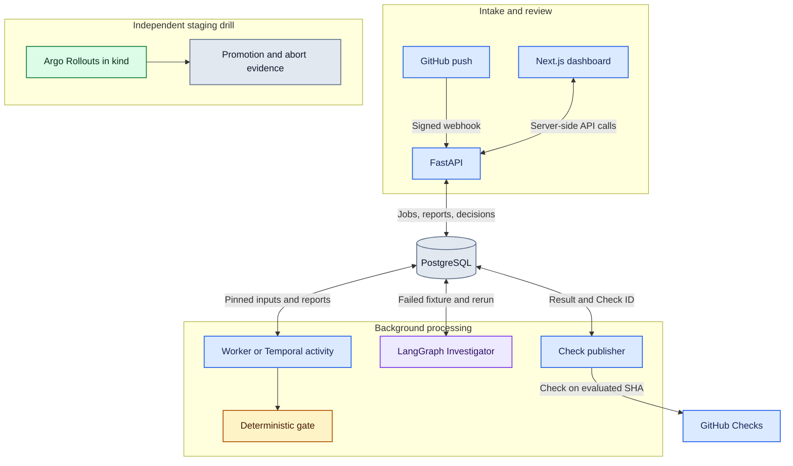
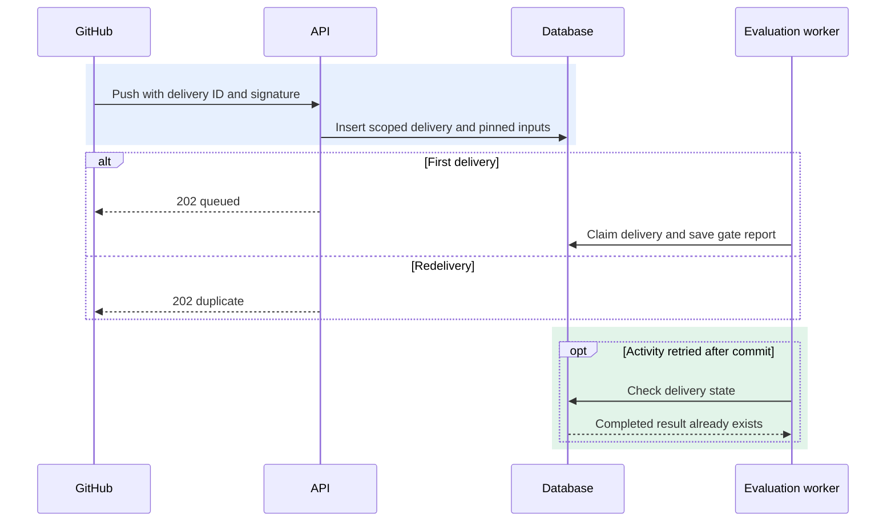

# Architecture

ReleaseTrace supports an operator-managed directory of GitHub repositories and installations. Reviewer accounts get roles per project, and release evidence is scoped to that repository and installation. The Compose demo uses shared role tokens for one project. Compose runs PostgreSQL, applies Alembic migrations, and starts FastAPI, the Python worker, and the Next.js dashboard. SQLite supports local service development.

## Repository map

| Path | Responsibility |
| --- | --- |
| `dashboard/app/actions.ts`, `dashboard/app/runs` | Sign-in and sign-out actions, release review pages, and approval and investigation actions |
| `dashboard/lib/session.ts` | Sign-in, browser cookie, and logout |
| `dashboard/lib/releases.ts` | Server-to-server release API client and response types |
| `service/api.py` | HTTP routes, project-scoped evidence queries, and digest-bound approval checks |
| `service/authentication.py`, `service/accounts.py`, `service/projects.py` | Key and session validation, current grant resolution, credential administration, and project directory validation |
| `service/store.py`, `service/migrations` | Database access, persistent state, and schema changes |
| `service/worker.py`, `service/temporal_worker.py` | Background evaluation, investigation, and Check publication |
| `service/evaluate_builds.py`, `service/evaluation_config.py` | Application evaluation and versioned project suites |
| `service/investigation_graph.py`, `service/github_check.py` | Controlled diagnostic reruns and formatting GitHub Checks |
| `runbook_rag` | Companion application tested by ReleaseTrace |
| `demo/pilot_rehearsal.py`, `demo/pilot_browser.py` | Isolated PostgreSQL backup and restore, operator workflow, and production dashboard session checks |
| `staging`, `.github/workflows` | Rollout tooling and CI |

The dashboard owns browser cookies. The API owns session validation and
project authorization. The worker owns outbound evaluation credentials, and
the rollout operator owns Kubernetes access. See [security and access](SECURITY.md)
for the credential lifecycle and deployment checks.

## System design

1. The API verifies the signature and project scope, deduplicates by delivery ID, and persists the queued inputs. Build mode snapshots the configured endpoints. Fixture mode records the push SHA as event provenance.
2. The worker evaluates both versions on the same cases and saves the gate result. The optional Temporal worker assigns one workflow ID per queue and delivery and reuses the database transaction to preserve a committed result on retry.
3. The dashboard reads scoped reports. The optional GitHub App publisher writes build results against the evaluated commit and tracks Check IDs and retries.
4. The Investigator reads a saved fixture evaluation, runs up to one allowlisted experiment, and records its diagnosis independently of the release verdict.
5. The API records reviewer decisions bound to the candidate digest. The Argo kind drill separately measures promotion, abort, and stable-service response.

For an approved GitHub build, the staging command reads the current authorization from the API and submits the exact digest to a named Argo Rollout. Kubernetes credentials stay with the operator. Argo controls canary analysis and aborts. With observation enabled, the command reads the controller's outcome and the available stable ReplicaSet, then records the evidence for display on the release page. The [operations guide](OPERATIONS.md#submit-an-approved-image-to-argo-rollouts) covers preview, submission, and observation.

Trace a signed push and a retried evaluation

See the [Temporal recovery drill](OPERATIONS.md#run-evaluations-with-temporal) for the test command.

CI has rehearsed the connected path from a locally signed delivery through evaluation and approval to a running Argo canary using real registry digests. See the [operations guide](OPERATIONS.md#rehearse-the-complete-path-in-ci) for the evidence and the [implementation plan](IMPLEMENTATION_PLAN.md) for live GitHub verification.
