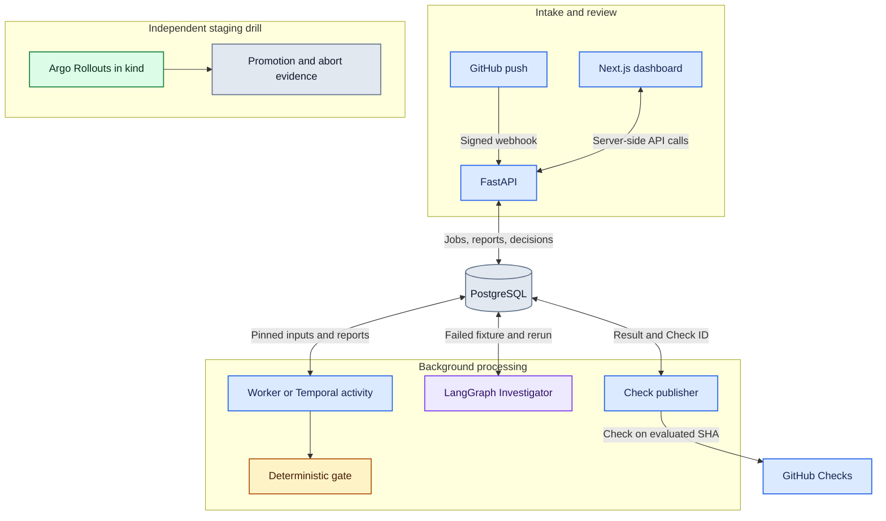
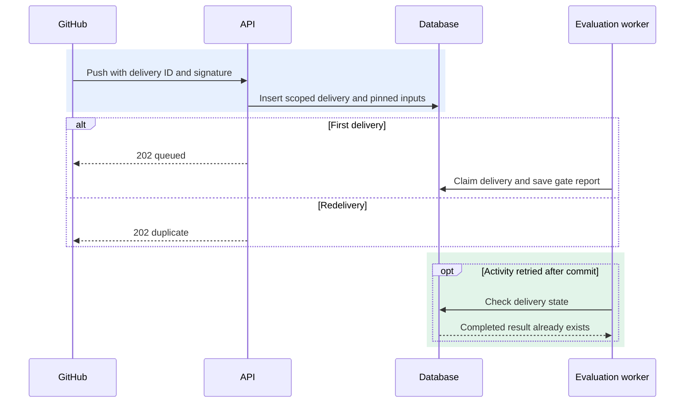

# Architecture

ReleaseTrace serves one configured GitHub repository and installation per API instance. Compose runs PostgreSQL, applies Alembic migrations, and starts FastAPI, the Python worker, and the Next.js dashboard. SQLite supports local service development.

## System design

1. The API verifies the signature and project scope, deduplicates by delivery ID, and persists the queued inputs. Build mode snapshots the configured endpoints. Fixture mode records the push SHA as event provenance.
2. The worker evaluates both versions on the same cases and saves the gate result. The optional Temporal worker assigns one workflow ID per queue and delivery and reuses the database transaction to preserve a committed result on retry.
3. The dashboard reads scoped reports. The optional GitHub App publisher writes build results against the evaluated commit and tracks Check IDs and retries.
4. The Investigator reads a saved fixture evaluation, runs up to one allowlisted experiment, and records its diagnosis independently of the release verdict.
5. The API records reviewer decisions bound to the candidate digest. The Argo kind drill separately measures promotion, abort, and stable-service response.

Trace a signed push and a retried evaluation

See the [Temporal recovery drill](OPERATIONS.md#run-evaluations-with-temporal) for the test command.

The [implementation plan](IMPLEMENTATION_PLAN.md) tracks live GitHub verification and deployment of approved OCI images. See the [operations guide](OPERATIONS.md) for configuration.
