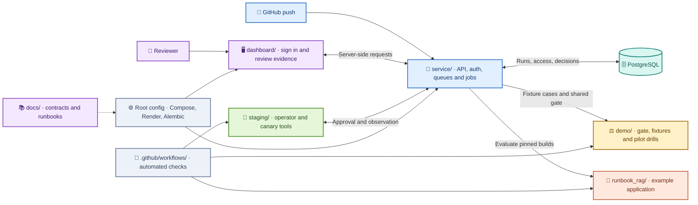
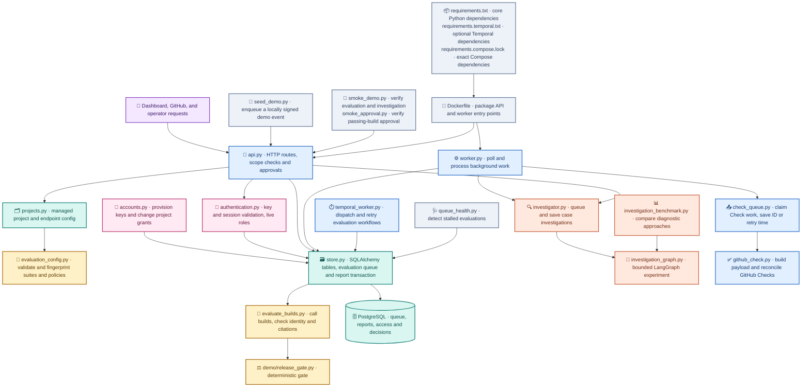
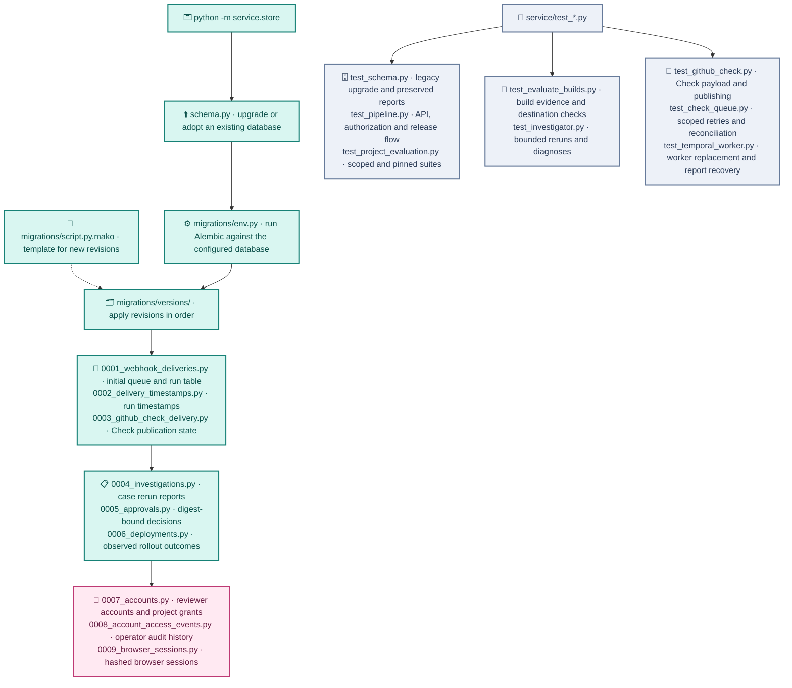
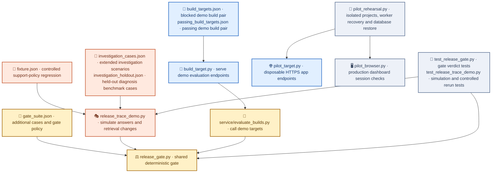
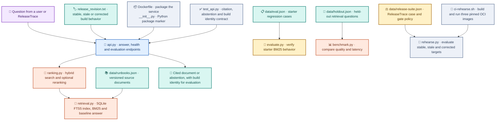
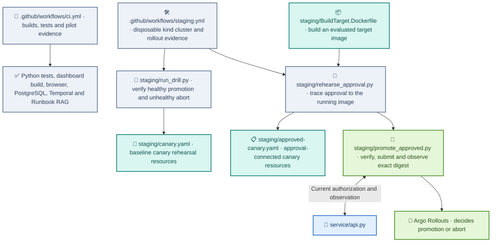
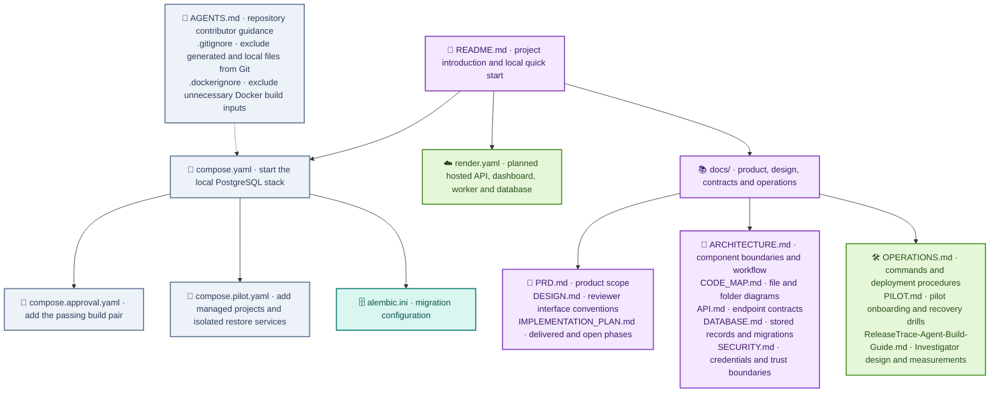

# ReleaseTrace file and folder flowcharts

Start with the repository overview, then open the chart for the part you want
to read. Arrows show a call, data flow, configuration relationship, or test
coverage. Where a node contains several filenames, each line explains one file.
See the [system architecture](ARCHITECTURE.md) for trust boundaries and the
complete release sequence.

**Color key.** Purple marks the reviewer experience and documentation, rose
marks access, blue marks requests and services, teal marks stored data and
configuration, amber marks evaluation rules, coral marks retrieval and
investigation, green marks deployment, and slate marks tooling and tests.
Every icon is paired with a text label.

## Repository overview

## Dashboard

Paths in this chart start at `dashboard/`. Bracketed segments in the route
paths are parameters from the URL.

```mermaid
flowchart TB
    Browser["👤 Reviewer browser"] --> Layout["🖼️ app/layout.tsx · shared page shell and sign-out"]
    Layout --> Home["🏠 app/page.tsx · sign-in, projects and release history"]
    Layout --> Run["📋 app/runs/[id]/page.tsx · verdict, evidence, approval and rollout"]
    Run --> Investigation["🔬 app/runs/[id]/investigations/[investigationId]/page.tsx · diagnosis and rerun"]
    Home --> History["🔍 app/run-history.tsx · search and filter the loaded runs"]
    Run --> Shared["🧩 app/components.tsx · status, timestamps and evidence"]
    Layout --> CSS["🎨 app/styles.css · shared layout and visual styling"]
    Home --> Actions["🎛️ app/actions.ts · sign-in, sign-out, approve and investigate"]
    Run --> Actions
    Actions --> Session["🔑 lib/session.ts · exchange key, manage session cookie"]
    Session --> Client["🔌 lib/releases.ts · server-only API client and response types"]
    Run --> Client
    Home --> Client
    Investigation --> Client
    Client --> API["⚡ service/api.py · authenticated API routes"]
    Config["⚙️ next.config.ts · standalone output and security headers<br/>tsconfig.json · TypeScript checks<br/>next-env.d.ts · generated Next.js types"] --> Layout
    Packages["📦 package.json · scripts and dependencies<br/>package-lock.json · resolved dependency versions"] --> Container["🐳 Dockerfile · build and run production Next.js"]
    Container --> Layout
    Guide["📘 AGENTS.md · local Next.js contributor guidance"] -.-> Config

    classDef review fill:#f3e8ff,stroke:#8b47c5,color:#401967,stroke-width:2px
    class Browser,Layout,Home,Run,Investigation,History,Shared,CSS review
    classDef access fill:#ffe9f2,stroke:#be3974,color:#641c41,stroke-width:2px
    class Actions,Session access
    classDef api fill:#e1efff,stroke:#3070c7,color:#15386a,stroke-width:2px
    class Client,API api
    classDef tool fill:#edf1f8,stroke:#667a9a,color:#2d3d57,stroke-width:2px
    class Config,Packages,Container,Guide tool
```

## Service runtime

Paths start at `service/`. The dashboard and webhooks feed the same API, and
background workers and operator tools use its saved records.

### Service migrations and tests

## Demo

## Runbook RAG

## Rollout tooling and GitHub Actions

## Root configuration and documentation

The diagrams cover repository source and configuration, plus the two local
dashboard files shown in the IDE. Local dependency, build, and virtual
environment directories are generated by the tools.
