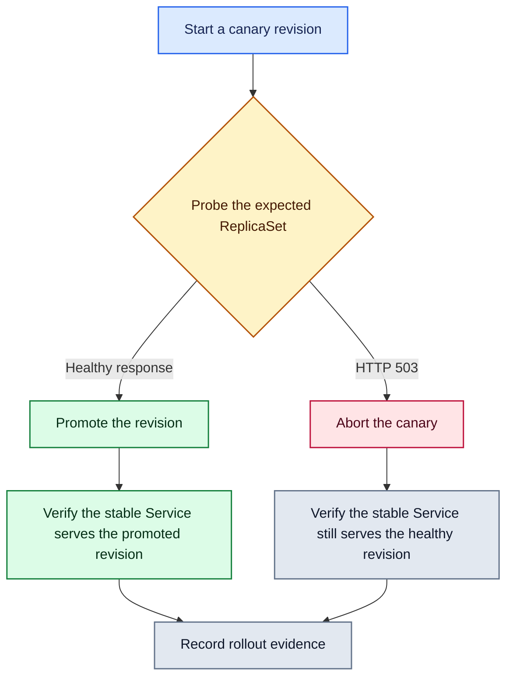

# Run and operate ReleaseTrace

Start with the [Compose walkthrough](../README.md#run-the-local-demo). This guide covers running individual processes, connecting real build endpoints and GitHub Checks, and running the optional workers and drills.

## Local verification

```bash
python -m pip install -r service/requirements.txt
python -m unittest discover -s demo -v
python -m unittest service.test_schema service.test_pipeline service.test_github_check service.test_evaluate_builds service.test_check_queue service.test_investigator service.test_project_evaluation -v
python -m service.investigation_benchmark
```

The dashboard CI job runs `npm ci` and `npm run build` from `dashboard/`. The PostgreSQL job runs the pipeline and Check queue tests against PostgreSQL 16. The Compose job runs both API smoke tests.

## Compose maintenance

Use `RELEASETRACE_API_PORT` or `RELEASETRACE_DASHBOARD_PORT` to change the host ports. Seed and smoke commands run inside the API container on its default port. Apply pending migrations with `docker compose run --rm --build migrate`.

Compose uses digest-pinned base images, the dashboard npm lockfile, and `service/requirements.compose.lock`. After a service dependency change, refresh the lock:

```bash
uv pip compile service/requirements.txt --universal --python-version 3.12 --no-header --output-file service/requirements.compose.lock
```

## Run the webhook and worker

By default, the service evaluates the checked-in synthetic fixture suite. It stores
the push commit SHA as event provenance and labels the result `synthetic_fixture`.

Install `service/requirements.txt`. Set the same `RELEASETRACE_DATABASE_URL` in
both terminals, using an absolute `sqlite:///` database URL for a local demo or
a `postgresql+psycopg://` URL for PostgreSQL. For the API, set
`RELEASETRACE_WEBHOOK_SECRET`, `RELEASETRACE_READ_TOKEN`,
`RELEASETRACE_REPOSITORY_ID`, and `RELEASETRACE_INSTALLATION_ID`.

```bash
python -m service.store
python -m uvicorn service.api:create_app --factory
```

Run `python -m service.store` before starting an updated API or worker. It
applies pending Alembic migrations and preserves existing demo runs. Runs
saved before timestamp tracking show their original times as unavailable.

### Configure managed projects and reviewer accounts

Set `RELEASETRACE_PROJECTS_FILE` on the API and operator CLI to an absolute path
to a server-managed JSON file. List the GitHub repository and installation IDs
that may send pushes. Use a stable organization slug and a display name for
each project. A build targets file is optional. Its path is relative to the
project file unless it is absolute.

```json
{
  "projects": [
    {
      "repository_id": 12345,
      "installation_id": 67890,
      "organization": "support-team",
      "name": "Support application",
      "github_repository": "example/support-app",
      "build_targets_file": "support-builds.json",
      "evaluation_file": "support-evaluation.json"
    }
  ]
}
```

Apply the migrations and provision accounts from a private operator terminal
with the same database URL and project file as the API.

```bash
python -m service.store
python -m service.accounts create release-reviewer
python -m service.accounts grant release-reviewer 12345 approver
python -m uvicorn service.api:create_app --factory
```

The create command displays an individual access key once and the database
stores a hash. Share the key privately with the reviewer. They enter it in
the dashboard and can switch between projects with active memberships. Grant
`viewer`, `maintainer`, or `approver` per project. To update a role, run
`grant` again. Use `revoke HANDLE REPOSITORY_ID` to remove a membership,
`rotate HANDLE` to replace a key, or `disable HANDLE` to invalidate it.
An approval records the authenticated account handle.

Install the same GitHub App on the listed repositories and configure its
webhook secret on the API. Rotate the secret on the API when it changes in
GitHub. If an evaluation target requires authentication, configure
`RELEASETRACE_BASELINE_EVALUATION_TOKEN_<repository_id>` and
`RELEASETRACE_CANDIDATE_EVALUATION_TOKEN_<repository_id>` on the evaluation
worker. Set `github_repository` on the managed entries that should publish
Checks. A worker uses that project's repository ID and installation ID to
scope each publication.

Serve the hosted dashboard and webhook over HTTPS. Managed mode accepts only
individual account keys. The database pins each managed repository to its
organization at startup, and the API rejects a configuration that moves a
repository to another organization or switches it back to shared tokens.
Restart API instances together when the project directory, build targets, or
evaluation files change. After an installation change, grant access under the
new installation.

### Define a project's evaluation

Set `evaluation_file` alongside `build_targets_file`. Both paths are resolved
relative to the project directory file unless absolute. Put the suite and
gate in the same file, as in this `support-evaluation.json` example:

```json
{
  "suite": {
    "revision": "support-v1",
    "cases": [
      {
        "case_id": "refund-window",
        "question": "How long do I have to request a refund?",
        "required_citation": "refunds-v2",
        "policies": [
          {"id": "refunds-v1", "revision": 1, "text": "Refunds are available for 14 days."},
          {"id": "refunds-v2", "revision": 2, "text": "Refunds are available for 30 days."}
        ]
      }
    ]
  },
  "policy": {
    "revision": "support-gate-v1",
    "minimum_score": 1.0,
    "critical_cases": ["refund-window"]
  }
}
```

Use unique case IDs and include the expected citation in each case's policy
catalog. Every case requires evidence. A verified wrong citation fails the
case. A failed critical case blocks the release even if the candidate meets
the score threshold. An unavailable or unrecognized citation is missing
evidence and prevents a passing gate. Both the baseline and candidate must
pass before an approver can approve the release.

The API validates up to 25 cases per suite and 512 KiB per evaluation file.
Bump the suite or policy revision when changing its content. The API records
the validated suite, policy, revisions, and SHA-256 fingerprints when it queues
a delivery. Fingerprints cover the normalized JSON of each section, including
its revision. The dashboard shows them under **Evaluation provenance**. After
an API restart, new deliveries use the updated files. Pending runs and
redeliveries of already queued IDs keep their original inputs. Projects without
an evaluation file use the checked-in demo cases.

In the second terminal, run `python -m service.worker`. A signed GitHub App
branch push to `/webhooks/github` queues one job per delivery ID. Read its state
and evidence at `/v1/runs/{delivery_id}` with the configured bearer token. The
API exposes `/healthz` and `/readyz`.

Use the same bearer token for these reviewer endpoints:

- `GET /v1/projects/{repository_id}/runs` lists commits, run states, and gate verdicts.
- `GET /v1/runs/{delivery_id}/cases?outcome=fail` lists failed candidate cases
  with the expected citation and evidence from both versions. Omit `outcome`
  to see every case.

Both lists accept `limit` (1 to 100, default 25) and `after`. Pass the returned
`next_cursor` as `after` to read the next page. Runs are ordered by delivery ID
and cases by case ID. A queued run returns an empty case list with its state.

For key-free SQLite migration and integration checks, run
`python -m unittest service.test_schema service.test_pipeline service.test_github_check -v`. The
PostgreSQL CI job applies the same migrations and runs the pipeline test
against a fresh PostgreSQL 16 database.

## Review a release in the dashboard

Start the API and worker using the local settings above. To create a sample run
without GitHub credentials, run `python -m service.seed_demo` against the local
API on port 8000. Set the same repository ID, installation ID, and webhook
secret in the terminal running the seed command. The worker picks up the sample
delivery and saves the gate decision. Repeating the command reuses that delivery.

The dashboard requires Node.js 20.9 or newer. It discovers available projects
from the API after sign-in and uses
`http://127.0.0.1:8000` by default. Set `RELEASETRACE_API_URL` if the API runs at
a different address.

```bash
cd dashboard
npm ci
npm run dev
```

Open [the local dashboard](http://localhost:3000) and enter the API's
`RELEASETRACE_READ_TOKEN`. Select the sample commit and then **Failed cases** to
see why the candidate was blocked. The dashboard accepts the configured viewer, maintainer, and approver tokens. Serve a hosted dashboard over HTTPS for its secure session cookie.

## Preview a GitHub Check

With the same database URL, repository ID, and installation ID used by the API,
run `python -m service.github_check <delivery_id>` after the worker completes
the evaluation. Fixture checks are neutral. Build checks report success after
a passing gate and failure after a blocked or inconclusive gate.

Publishing is a separate, explicit step for a completed delivery from GitHub.
Configure `RELEASETRACE_GITHUB_REPOSITORY` (`owner/repo`),
`RELEASETRACE_GITHUB_APP_ID`, and `RELEASETRACE_GITHUB_INSTALLATION_TOKEN` from
the configured installation with repository **Checks: write** access. Run
`python -m service.github_check <delivery_id> --publish`. Run publish commands
for the same delivery serially. A retry first looks for an existing check from
the app with the same reference. The local seed uses a placeholder SHA and is
available for preview.

## Evaluate two running builds

The endpoint evaluator calls both builds with the same checked-in test cases
and prints a JSON report with dataset, policy, and build fingerprints. For a
key-free demonstration, start each target in a separate terminal after
installing `service/requirements.txt`:

```bash
python -m demo.build_target baseline
python -m demo.build_target candidate
```

In a third terminal, run:

```bash
python -m service.evaluate_builds demo/build_targets.json
```

The candidate still passes 80% of the cases. Its wrong account-closure citation
blocks the release. Exit codes are `0` for pass, `1` for block, and `2` for an
inconclusive run or invalid command configuration.

### Application evaluation HTTP contract

Use the [build target file shape](../demo/build_targets.json) to configure a
baseline and candidate URL. Serve each endpoint over HTTPS outside loopback.
The worker sends one JSON `POST` per case to each build. For example:

```json
{"case_id":"refund-window","question":"How long do I have to request a refund?"}
```

Return HTTP 200 and JSON with the actual build's identity and the citation
produced by the application:

```json
{
  "build": {
    "commit_sha": "2222222222222222222222222222222222222222",
    "image_digest": "sha256:2222222222222222222222222222222222222222222222222222222222222222"
  },
  "citation": "refunds-v2"
}
```

Use a full lowercase 40-character commit SHA and a SHA-256 OCI digest from
trusted deployment metadata. These must match the configured target. Return
`null` when the application cannot cite a source. ReleaseTrace compares the
citation to the saved case's expected citation. Endpoint errors, unrecognized
citations, identity mismatches, redirects, and invalid responses yield missing
evidence. Send an uncompressed response of at most 16 KiB and respond within
the worker's five-second timeout. If the app requires authentication, configure
the [project-scoped bearer tokens](#configure-managed-projects-and-reviewer-accounts)
on the worker. The stand-alone demo and legacy workers use the same token names
without the repository suffix.

### Run build evaluations from GitHub pushes

Managed projects configure `build_targets_file` in the project directory.
For the single-project demo, set `RELEASETRACE_BUILD_TARGETS_FILE` on the API.
Restart the API when the build pair changes. The candidate must be deployed and its
commit SHA must match the signed push. The API snapshots the build pair with
the job. In this mode, pushes for other commits are ignored. Optional tokens
belong in the worker's environment. Scope them to their respective endpoints.

To run the full flow locally, start both demo targets, set
`RELEASETRACE_BUILD_TARGETS_FILE=demo/build_targets.json` on the API, and start
the API and worker. Run `python -m service.seed_demo --targets demo/build_targets.json`
and open the resulting run in the dashboard. Use its delivery ID to preview
the GitHub Check.

### Publish build checks automatically

Run `python -m service.store` to apply migrations. Install the GitHub App with
repository **Checks: write** on each selected repository. Set
`RELEASETRACE_GITHUB_APP_ID` and `RELEASETRACE_GITHUB_APP_KEY_FILE` on the
worker. Store the App's private PEM outside the repository. In managed mode,
give the worker the same `RELEASETRACE_PROJECTS_FILE` and referenced files as
the API. Include `github_repository` in each entry that should publish. The
same App key can cover several installations. The worker requests a
repository-scoped token per publication and checks that GitHub resolves the
configured name to the saved repository ID before publishing. Entries that
omit the name still support evaluations and review. Restart the worker after
an operator changes the directory or App credentials.

For the single-project configuration, set `RELEASETRACE_GITHUB_REPOSITORY`
(`owner/repo`), `RELEASETRACE_REPOSITORY_ID`, and
`RELEASETRACE_INSTALLATION_ID` on the worker instead of the managed directory.

Start `python -m service.worker --publish-checks`. It publishes completed build
checks for the configured repository, records the Check ID, and retries
temporary failures. Earlier completed build deliveries are also eligible.
Seeded demo deliveries and synthetic fixtures are preview-only in this worker.
Use the automated publisher or the manual publishing command for a delivery.

For the Render pilot, mount the project files and App PEM as worker secret
files and set the worker command to `python -m service.worker --publish-checks`
when the App is ready. A deployment that only runs evaluations can use the
Blueprint's default worker command.

### Verify live GitHub App redelivery

Use a demo repository you control and an HTTPS endpoint that routes GitHub to
`/webhooks/github`. Configure the App for push events with repository
**Contents: read** and **Checks: write**, install it on that repository, and
configure the API webhook secret and worker key on the host. Deploy the two
evaluation targets with the real build identities. Set the candidate SHA in
the target file before delivering the push. The local Compose demo uses test
IDs and credentials. [GitHub push event permissions](https://docs.github.com/en/webhooks/webhook-events-and-payloads#push)

1. Record the push delivery GUID and candidate SHA. Read
   `GET /v1/runs/{delivery_id}` and wait for `github_check_id`. The saved run's
   `commit_sha` and GitHub Check's `head_sha` should both match the candidate SHA.
   The Check's `external_id` should equal the delivery GUID.
2. Redeliver that same push from the GitHub App's **Recent deliveries**. The API
   should return HTTP 202 with `status: duplicate`. Confirm the saved run keeps
   its original Check ID. List the Check runs for that exact SHA and confirm
   there is exactly one from the App with that name and delivery GUID.
   [GitHub App redelivery](https://docs.github.com/en/webhooks/testing-and-troubleshooting-webhooks/redelivering-webhooks#redelivering-github-app-webhooks) · [Check Runs API](https://docs.github.com/en/rest/checks/runs#list-check-runs-for-a-git-reference)

## Run evaluations with Temporal

Install the optional dependencies with
`python -m pip install -r service/requirements.temporal.txt`. Apply migrations
with `python -m service.store` and start the API with the same database URL.
For local development, start a Temporal CLI server with `temporal server start-dev`
in another terminal, then run `python -m service.temporal_worker`. Run
`python -m service.worker --auxiliary-only` for investigations and add
`--publish-checks` there if you have configured GitHub Check publishing.

The signed webhook commits the queued delivery before the Temporal worker
dispatches it. Temporal uses the delivery ID to deduplicate workflow starts.
If a worker exits before an evaluation commits, the next attempt can retry
it. If the result was committed before the interruption, the retry returns
without rewriting it. A remote or timed-out evaluation request may be repeated.
Use a dedicated Temporal namespace or task queue for each shared database.
The local defaults are `127.0.0.1:7233`, namespace `default`, and queue
`releasetrace-evaluations`. Set `RELEASETRACE_TEMPORAL_ADDRESS`,
`RELEASETRACE_TEMPORAL_NAMESPACE`, or `RELEASETRACE_TEMPORAL_TASK_QUEUE`
to override them.

Run `python -m unittest service.test_temporal_worker -v` for the key-free
recovery drill. The SDK downloads and starts a temporary test server. The
test replaces the evaluation worker after an injected acknowledgement
failure and checks that the saved report and timestamp are preserved.

## Record a protected release decision

Apply migrations with `python -m service.store`. Set
`RELEASETRACE_APPROVER_TOKEN` to a separate approver credential and
`RELEASETRACE_APPROVER_ACTOR` to the reviewer's audit name on the API.
Sign in to the dashboard with the approver token and open the build run.
The run page shows the available decisions and the saved decision. To use
the API, send `POST /v1/runs/{delivery_id}/approval` with that bearer token and
`{"decision":"approve","image_digest":"sha256:<64 lowercase hex digits>"}`.
Use the candidate digest from the saved build report. Approval requires a
completed, passing build evaluation for the configured candidate. An
approver can also record `reject` for a completed build evaluation.
Repeating the same decision returns the original record and timestamp.

The running API's target configuration defines the current candidate.
Restart the API when the target file changes, and switch all serving instances
to the same configuration before accepting approvals for a new candidate.
Requests for a superseded candidate return HTTP 409. The endpoint records a
decision in the database.

## Submit an approved image to Argo Rollouts

Run this workflow for a completed passing GitHub build evaluation with a saved
approval. Use a staging kubeconfig with access to read and patch the named
Rollout. Install the service requirements and set `RELEASETRACE_APPROVER_TOKEN`
in the command's environment.

```bash
python -m staging.promote_approved DELIVERY_ID --api-url https://releasetrace.example.com --context staging --namespace app --rollout support --container app
```

The command previews the image reference. Add `--apply` to submit it. The
Rollout must use a canary strategy and its named container must currently use
the evaluated baseline digest in the same image repository. The API rejects
stale build pairs, rejected or missing approvals, and seeded demo runs. The
command uses a conditional patch with the Rollout's resource version and
leaves the existing canary analysis and abort behavior to Argo. Run with the
same arguments again to check whether the candidate is already configured.

Keep candidate configuration consistent across serving API instances and
coordinate target configuration changes with staging submissions.
`submitted` means Kubernetes accepted the patch. Add `--apply --observe 120`
to record the terminal outcome on the release page. The observer waits for
Argo to report the submitted generation and checks the available stable
ReplicaSet's digest. Grant the operator permission to list ReplicaSets in
the Rollout namespace when using this option. If the wait times out, rerun
with `--observe 120` to resume observation of the already configured
candidate while the evaluated build pair remains current.

### Rehearse the complete path in CI

Run **ReleaseTrace canary drill** from the Actions tab. The workflow builds
two support application images from the checked-out commit and pushes them to
a registry on the disposable runner. The rehearsal starts both images by
their manifest digests and sends a locally signed GitHub-shaped push through
the normal API and worker. It verifies deduplication and a passing gate,
checks that promotion requires approval, and records approval for the
evaluated digest.

The staging command submits that digest to Argo in kind. The inline analysis
checks the canary's reported identity and account-closure citation. The
rehearsal checks that the viewer can read the saved outcome, verifies the
running Pods' image IDs, and calls the stable Service. Download `approved-rollout-evidence.json` from the
`approved-rollout-evidence` artifact to compare the approved digest,
submitted reference, stable Pod identities, and successful AnalysisRun.

The rehearsal uses synthetic policy cases and a locally generated delivery.
Live GitHub App delivery and Check publishing use the
[live redelivery checklist](#verify-live-github-app-redelivery).

## Run the staging canary drill

The canary workflow creates a disposable kind cluster and runs Argo Rollouts
against a synthetic HTTP service. It promotes a healthy revision, then
submits an unhealthy revision that returns HTTP 503. The drill verifies that
the analysis fails, the controller aborts, and the stable service still serves
the healthy revision. The GitHub Actions workflow uploads
`rollout-evidence.json` with ReplicaSet hashes, AnalysisRun names, and measured
time to detection and to the stable service probe.

<details>
<summary>Explore both canary outcomes</summary>



</details>

For a local drill, install Argo Rollouts in a test cluster and create a fresh
namespace. Run `python staging/run_drill.py --context YOUR_TEST_CONTEXT --namespace YOUR_DRILL_NAMESPACE`.
The drill uses synthetic revisions. Deployments driven by saved ReleaseTrace
approvals remain a separate integration step.

## Investigate a failed synthetic case

Apply migrations with `python -m service.store` and configure a separate
`RELEASETRACE_MAINTAINER_TOKEN` on the API. Sign in to the dashboard with that
token, open a completed synthetic run, and select **Investigate** on a failed
case. Refresh the report when the worker finishes. The case then has a **View
investigation** link for both maintainers and viewers.

To start the same flow from the API,
send `POST /v1/runs/{delivery_id}/investigations` with the maintainer bearer
token and `{"case_id":"account-closure"}`. The same run and case return the
same investigation ID on retry.

The worker executes the rerun. Read it with the viewer or maintainer token at
`GET /v1/runs/{delivery_id}/investigations/{investigation_id}`. The saved report
shows the stable and candidate evidence, the retrieval change, and its result.
An investigation can support a diagnosis or return inconclusive. The release
verdict is recorded separately.

The worker runs this workflow with LangGraph and a scripted local planner. It
can execute one experiment per investigation. To also try a prompt regression,
a stale recorded tool response, and an ambiguous failure, set
`RELEASETRACE_EXTENDED_FIXTURES=1` before starting the API or Compose stack.
Run `python -m service.seed_demo --extended` (via `docker compose exec -T api`
when using Compose), then investigate cases in the new run. This demo requires
no model credentials.

### Measure the Investigator locally

Run `python -m service.investigation_benchmark` for the versioned synthetic
holdout report. It compares a rule that names the only changed setting with
the scripted Investigator, which can run one experiment before diagnosing.
The frozen suite covers six cases across different support topics than the
development fixtures. Four have a known single-setting fix. A `null` label
means abstention is expected. The report includes the dataset fingerprint,
per-case findings, diagnosis and abstention counts, and experiments executed.

For the hosted comparison, set `OPENAI_API_KEY` in your environment and run
`python -m service.investigation_benchmark --model YOUR_MODEL_ID` with an
OpenAI Chat Completions model that supports JSON mode. The command sends the
same synthetic starting evidence to both model methods. Each method makes one
request per case, for twelve requests across the holdout. The experiment
method records a diagnosis only when the controlled rerun establishes it.
The JSON report includes the returned model ID, token counts, elapsed time
and per-case reasons. A failed provider request exits with an error so it
doesn't count as an abstention.
