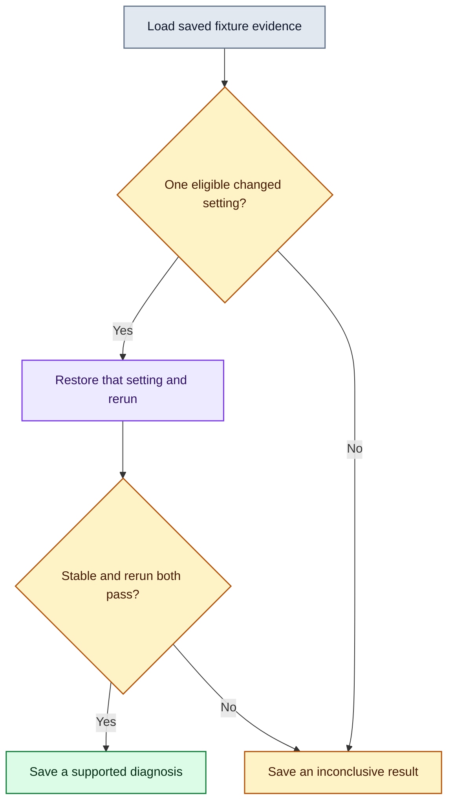
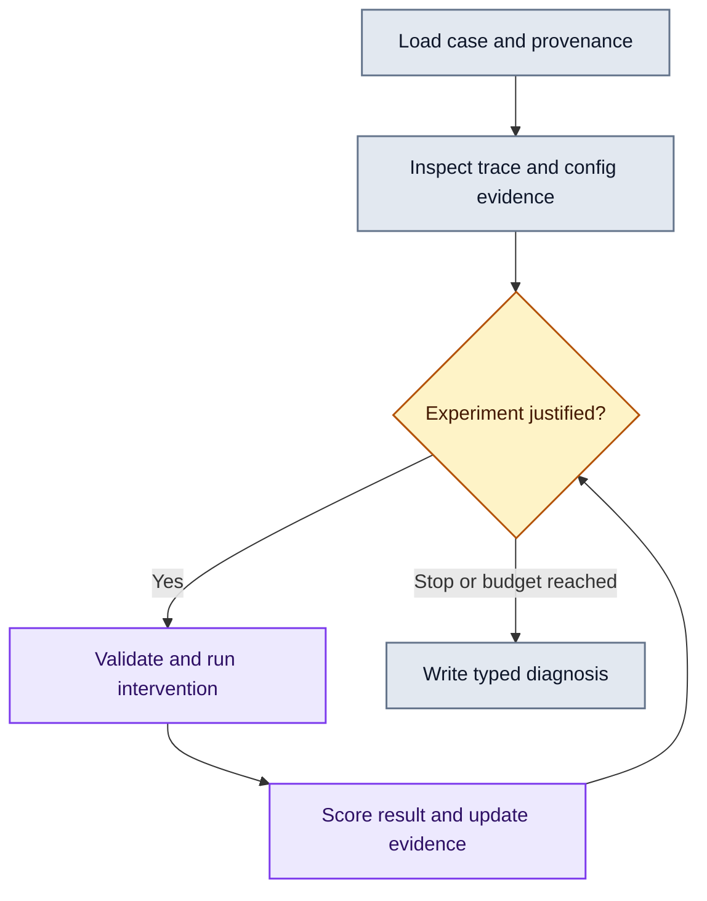

# ReleaseTrace
## Investigator design and benchmark

ReleaseTrace is the platform. **Investigator** is the feature reviewers use to examine a failed case through a controlled rerun. See the [implementation plan](IMPLEMENTATION_PLAN.md) for platform milestones and the [README](../README.md) for the runnable demo.

**User outcome.** From a failed release check, an engineer can learn which change is most likely responsible, which experiment supports that diagnosis, and what evidence is still missing.

**Research question.** Under an explicit cost and experiment budget, does an investigator that can run controlled reruns diagnose more regressions correctly than a model that only reads the same initial evidence?

## 1. First user workflow

### Local demo today

Complete a synthetic release run, sign in to the dashboard with the project maintainer token, and open the failed account-closure case. Select **Investigate**. The worker restores the stable retrieval setting for that case while preserving the candidate prompt. The saved report compares the stable response, candidate response, and rerun. A viewer can open the report after it has been requested. The release gate retains its original verdict.

LangGraph runs the local investigation with a scripted planner and a budget of one experiment. The allowlist covers retrieval, prompt, and recorded tool response. The planner abstains when several settings differ. The held-out benchmark can also run with a hosted model. Staging experiments remain planned.

### Planned connected workflow

1. A developer opens the failing case from a GitHub check. Both stable and candidate runs have completed on the same versioned case.
2. The developer selects **Investigate**. The service starts a run for that exact evaluation, case, and candidate artifact.
3. The agent reads the trace and configuration differences. It selects one permitted intervention, such as restoring baseline retrieval while keeping the remaining candidate settings pinned.
4. The evaluator reruns the case in an isolated fixture or staging environment. The same scoring rule checks the new result.
5. The developer sees a diagnosis, evidence links, what changed in the experiment, trial results, and a suggested next check. They can open the exact artifact behind each claim.
6. The developer makes a fix through the normal PR workflow. The evaluator owns the release verdict and the rollout controller owns deployment.

**Verified fixture outcomes.** The candidate cites policy v1 where v2 is required. Swapping retrieval settings restores the correct citation. A separate test covers a case where the swap leaves the result inconclusive.

## 2. Stack and module boundaries

FastAPI and Pydantic expose the investigation API. SQLAlchemy and Alembic persist work and results. LangGraph runs the scripted planner for the dashboard workflow. The benchmark CLI provides the optional hosted model adapter. Temporal can run release evaluations while the standard worker handles investigations.

| Module | Responsibility |
|---|---|
| [`service/api.py`](../service/api.py) | Typed requests, project access, and investigation reports |
| [`service/investigator.py`](../service/investigator.py) | Investigation queue and inputs from the saved evaluation |
| [`service/investigation_graph.py`](../service/investigation_graph.py) | Scripted planner, experiment limits, retrieval rerun, and diagnosis |
| [`demo/release_trace_demo.py`](../demo/release_trace_demo.py) | Shared citation scorer and controlled experiment |
| [`service/worker.py`](../service/worker.py) | Background execution and report persistence |
| [`dashboard/app/runs/`](../dashboard/app/runs/) | Open the failed case and compare investigation evidence |
| [`service/test_investigator.py`](../service/test_investigator.py) and [`service/test_pipeline.py`](../service/test_pipeline.py) | Diagnosis, abstention, access, and retry checks |

Initial runs and controlled experiments share the fixture scorer.

## 3. Contracts and boundaries

The current API accepts a saved synthetic run ID and failed case ID. The worker reads the pinned inputs and records one investigation per run and case. Reports are **supported** or **inconclusive** and can include one experiment. The table describes proposed contracts for a multi-experiment investigator.

| Object | Required fields |
|---|---|
| InvestigationRequest | Project, evaluation and case IDs; baseline and candidate artifact references; evaluator, dataset, and scoring policy revisions; run budget |
| EvidenceItem | Stable evidence ID, originating artifact, redacted excerpt or score, and evidence kind |
| ExperimentRequest | Investigation and case IDs, intervention enum, requested repeats, and idempotency key |
| ExperimentResult | Experiment ID, full version manifest, changed parameter, trial counts and outcomes, scorer outputs, evidence IDs and execution status |
| DiagnosisReport | Outcome, hypothesis, evidence IDs, experiment results, uncertainty, and recommended next check |

For the proposed multi-experiment workflow, expose tool timeouts and missing data in the report. Enforce project and case scope at service and tool boundaries. Treat traces and retrieved text as input data. Restrict tool access to evidence reads and evaluator requests. Keep deploy credentials and production actions outside the agent runtime.

## 4. Proposed multi-experiment graph

| Tool | Behavior |
|---|---|
| inspect_failed_case | Return stable and candidate scores, expected behavior, failed assertions, and filtered trace evidence |
| compare_release_config | Return supported differences in model, prompt, retrieval, or tool configuration with artifact IDs |
| run_controlled_experiment | Run a single allowlisted intervention against the pinned candidate in fixture or staging mode |

The current fixture graph can restore the baseline prompt or retrieval configuration, or replay a recorded baseline tool response. The tool response uses a fake integration. The proposed graph would distinguish an isolated cause from a workaround.

Any larger experiment budget should remain server-enforced, with bounded graph steps, wall-clock time, and model usage. Deduplicate interventions under retries using case and artifact identity. Count repeated trials explicitly and require evidence for a passing result.

When candidate behavior is stochastic, record repeats for both candidate and intervention where feasible. Two variables may interact, so a successful swap supports a hypothesis under the tested conditions. Preserve contradictory evidence and abstain when the finding is weak or ambiguous. Validate report citations against evidence captured in the current run.

## 5. Benchmark the contribution

The first offline benchmark is in [`demo/investigation_holdout.json`](../demo/investigation_holdout.json). Run `python -m service.investigation_benchmark` to compare the scripted Investigator with its decision rule alone. Expected labels stay in the benchmark harness. These six synthetic cases measure citation diagnosis under the fixture scorer. The optional `--model` comparison uses the same model and starting evidence for a one-shot diagnosis and an experiment selection. LangGraph verifies the experiment selection with the fixture scorer.

On `synthetic-holdout-v1`, both methods correctly diagnosed three of four diagnosable cases. The rule made one wrong diagnosis in the tax form case, where the expected policy was absent. The Investigator used four experiments and correctly abstained on that case. Both methods abstained on the diagnosable membership case when the prompt and retrieval settings changed together.

- Build development fixtures for outdated retrieval, prompt changes, and incorrect tool arguments or responses. Include clean releases, ambiguous failures, and missing-evidence examples.
- Group variants of the same fault together when splitting development and held-out cases. Freeze the held-out revision and label expected diagnoses outside the agent inputs.
- Compare three approaches: deterministic triage rules, a one-shot LLM, and the tool-using agent. Use the same starting evidence for each. Use the same model for both LLM approaches and document the difference in tool access and budget.
- Report correct diagnoses divided by all diagnosable cases, accuracy among answered cases, abstention coverage and correctness, evidence citation validity, experiments per case, latency, and model cost. Include denominators and at least one error analysis. Label fixture results and live-model results separately.
- Report where a simpler method wins. The experiment-enabled agent justifies its cost if it improves decisions on cases worth investigating.

## 6. Implementation phases

| Phase | Codex task | Acceptance criteria |
|---|---|---|
| 1. Reproduce a failure | Complete. The fixture scorer and retrieval swap run locally. | One intervention restores the expected citation. The rerun changes only retrieval. |
| 2. Connect the controlled rerun | Complete for synthetic runs. Queue requests, persist results, and compare them in the dashboard. | Maintainer requests deduplicate. Viewers can read the saved report. The original gate remains intact. |
| 3. Build the graph | Complete for the three local interventions. | The scripted planner handles supported and inconclusive cases. The graph rejects unavailable interventions and stops at its budget. |
| 4. Measure it | Offline results are available. The optional hosted adapter is implemented. | Collect hosted results and analyze diagnosis errors, abstentions, token usage, and latency. |
| 5. Connect real build evidence | The separate canary drill has recorded an abort. Deployment-backed investigations are planned. | A reviewer can trace a live failed check to a diagnosis backed by a controlled rerun. |

## 7. Next implementation step

Run the optional hosted benchmark on the frozen holdout and record the selected model, per-case outcomes, usage, and failure modes. See the [benchmark commands](OPERATIONS.md#measure-the-investigator-locally).
