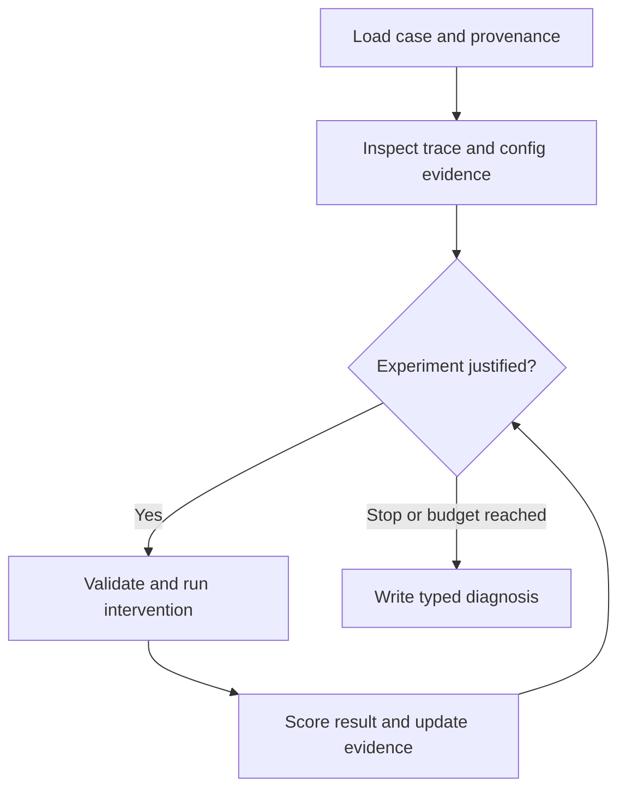

# ReleaseTrace
## Experimental diagnosis agent · Codex build guide

ReleaseTrace is the working name for VerifiAI. This guide expands the investigation section of the existing platform guide. Use the existing guide for GitHub release checks, Temporal, the dashboard, and staged deployment. Use this guide to build the diagnosis agent and demonstrate whether it improves on simpler approaches.

**User outcome.** From a failed release check, an engineer can learn which change is most likely responsible, which experiment supports that diagnosis, and what evidence is still missing.

**Research question.** Under an explicit cost and experiment budget, does an investigator that can run controlled reruns diagnose more regressions correctly than a model that only reads the same initial evidence?

## 1. First user workflow

1. A developer opens the failing case from a GitHub check. Both stable and candidate runs have completed on the same versioned case.
2. The developer selects **Investigate**. The service starts a run for that exact evaluation, case, and candidate artifact.
3. The agent reads the trace and configuration differences. It selects one permitted intervention, such as restoring baseline retrieval while keeping the remaining candidate settings pinned.
4. The evaluator reruns the case in an isolated fixture or staging environment. The same scoring rule checks the new result.
5. The developer sees a diagnosis, evidence links, what changed in the experiment, trial results, and a suggested next check. They can open the exact artifact behind each claim.
6. The developer makes a fix through the normal PR workflow. The evaluator owns the release verdict and the rollout controller owns deployment.

**First demo.** The candidate cites policy v1 where v2 is required. Swapping retrieval settings restores the correct citation. Show the baseline, candidate, and intervention side by side. Add a second case where the available reruns cannot distinguish competing explanations and the report is inconclusive.

## 2. Stack and module boundaries

Use Python, LangGraph, Pydantic, pytest, and one model-provider SDK behind a small adapter. Use a scripted model adapter for deterministic local tests. Integrate with the existing FastAPI, PostgreSQL, and worker setup when the CLI path is stable. Temporal can coordinate the enclosing release workflow later.

| Module | Responsibility |
|---|---|
| packages/investigation/contracts.py | Typed requests, tool results, experiments, reports |
| packages/investigation/graph.py | Agent state, transitions, tool dispatch and stop conditions |
| packages/investigation/tools.py | Read evidence and submit validated experiment requests |
| packages/evaluation/ | Execute and score baseline, candidate, and intervention runs |
| apps/worker/ | Run the investigation asynchronously and persist results |
| tests/investigation/ | Fixture, failure, budget, and benchmark tests |

Follow the existing module layout if implementation has begun. Share schemas and reuse evaluation scoring across initial runs and experiments.

## 3. Contracts and boundaries

| Object | Required fields |
|---|---|
| InvestigationRequest | Project, evaluation and case IDs; baseline and candidate artifact references; evaluator, dataset, and scoring policy revisions; run budget |
| EvidenceItem | Stable evidence ID, originating artifact, redacted excerpt or score, and evidence kind |
| ExperimentRequest | Investigation and case IDs, intervention enum, requested repeats, and idempotency key |
| ExperimentResult | Experiment ID, full version manifest, changed parameter, trial counts and outcomes, scorer outputs, evidence IDs and execution status |
| DiagnosisReport | Outcome, hypothesis, evidence IDs, experiment results, uncertainty, and recommended next check |

Use outcomes **supported**, **inconclusive**, and **investigation_failed**. A tool timeout or missing required data must be visible in the report. Enforce project and case scope at service and tool boundaries. Treat traces and retrieved text as input data. Restrict tool access to evidence reads and evaluator requests. Keep deploy credentials and production actions outside the agent runtime.

## 4. Graph and tool behavior



| Tool | Behavior |
|---|---|
| inspect_failed_case | Return stable and candidate scores, expected behavior, failed assertions, and filtered trace evidence |
| compare_release_config | Return supported differences in model, prompt, retrieval, or tool configuration with artifact IDs |
| run_controlled_experiment | Run a single allowlisted intervention against the pinned candidate in fixture or staging mode |

Start with three interventions: restore the baseline prompt, restore the baseline retrieval configuration, and replay a recorded baseline tool response. The tool response uses a fake integration. Report whether the experiment isolates a suspected cause or merely bypasses the failure.

Set a server-enforced default limit of three experiments, a finite graph step count, a wall-clock timeout, and a per-run model budget. Deduplicate the same canonical intervention under retries, including case and artifact identity in the key. Count repeated trials explicitly. Never interpret a missing result as a passing run.

When candidate behavior is stochastic, record repeats for both candidate and intervention where feasible. Two variables may interact, so a successful swap supports a hypothesis under the tested conditions. Preserve contradictory evidence and abstain when the finding is weak or ambiguous. Validate report citations against evidence captured in the current run.

## 5. Benchmark the contribution

- Build development fixtures for outdated retrieval, prompt changes, and incorrect tool arguments or responses. Include clean releases, ambiguous failures, and missing-evidence examples.
- Group variants of the same fault together when splitting development and held-out cases. Freeze the held-out revision and label expected diagnoses outside the agent inputs.
- Compare three approaches: deterministic triage rules, a one-shot LLM, and the tool-using agent. Use the same starting evidence for each. Use the same model for both LLM approaches and document the difference in tool access and budget.
- Report correct diagnoses divided by all diagnosable cases, accuracy among answered cases, abstention coverage and correctness, evidence citation validity, experiments per case, latency, and model cost. Include denominators and at least one error analysis. Label fixture results and live-model results separately.
- Report where a simpler method wins. The experiment-enabled agent justifies its cost if it improves decisions on cases worth investigating.

## 6. Implementation phases

| Phase | Codex task | Acceptance criteria |
|---|---|---|
| 1. Reproduce a failure | Create the key-free sample case, pinned artifact manifests, and experiment runner. | One intervention restores the expected citation. The manifest confirms only the intended parameter changed. Repeat requests produce one logical experiment. |
| 2. Build the graph | Implement tools, transitions, typed report validation, and a scripted local adapter. | The agent can select the useful experiment, handle an ambiguous case, and stop at the budget. Unsupported intervention and cross-project reads are rejected. |
| 3. Measure it | Add the hosted model adapter and benchmark all three methods. | The report contains actual results, costs where measurable, denominators, and failed diagnoses. A provider timeout ends in a visible failure or inconclusive result. |
| 4. Connect it to the platform | Add asynchronous worker invocation, persisted results, and the dashboard flow. | A reviewer can open a PR check, investigate a specific case, inspect evidence, and recover from worker redelivery without duplicate logical experiments. |
| 5. Finish the flagship demo | Show diagnosis, corrected release, and deployment using the platform guide. | A reviewer can reproduce the local investigation and inspect a recorded canary abort drill. |

## 7. First prompt to paste into Codex

```text
Read AGENTS.md if present, this agent guide, and the existing platform guide. Inspect the repo and preserve existing contracts. Implement Phase 1 only. Build one outdated-policy citation scenario with pinned baseline and candidate configurations, a fixture evaluator, and a controlled retrieval swap. Reuse the same scoring rule across all variants. Emit a structured report showing the manifest, changed parameter, score and evidence. Provide a documented local command that requires no hosted model, cloud credentials or cluster. Test the single-variable invariant, retry deduplication and missing evidence. Run the checks and report what passed and what remains unverified.
```

For later phases, provide the previous acceptance results and request one phase at a time. Keep platform-wide instructions in the repository's AGENTS.md and put this file under docs/.

## 8. Naming shortlist

| Name | Emphasis |
|---|---|
| **ReleaseTrace** | The full release workflow with a traceable diagnosis |
| **RevisionLab** | Controlled experiments across application versions |
| **RegressionLab** | Technical and direct, with emphasis on reproducing regressions |
| **CanaryLens** | Release observation and rollout analysis |
| **ChangeProof** | Evidence for release decisions |

Use **ReleaseTrace** for the platform and **Investigator** for the feature users launch from a failed case. These are working names. Availability has not been checked.
