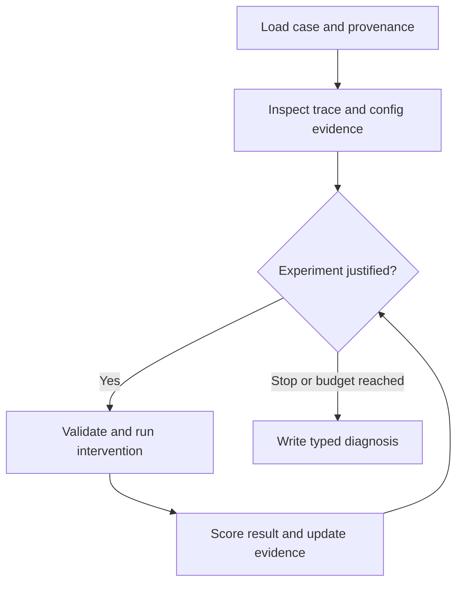

# ReleaseTrace
## Experimental diagnosis agent · Codex build guide

ReleaseTrace is the platform. **Investigator** is the feature reviewers use to examine a failed case through a controlled rerun. See the [implementation plan](IMPLEMENTATION_PLAN.md) for platform milestones and the [README](../README.md) for the runnable demo.

**User outcome.** From a failed release check, an engineer can learn which change is most likely responsible, which experiment supports that diagnosis, and what evidence is still missing.

**Research question.** Under an explicit cost and experiment budget, does an investigator that can run controlled reruns diagnose more regressions correctly than a model that only reads the same initial evidence?

## 1. First user workflow

### Local demo today

Complete a synthetic release run, sign in to the dashboard with the project maintainer token, and open the failed account-closure case. Select **Investigate**. The worker restores the stable retrieval setting for that case while preserving the candidate prompt. The saved report compares the stable response, candidate response, and rerun. A viewer can open the report after it has been requested. The release gate retains its original verdict.

LangGraph runs the local investigation with a scripted planner and a budget of one retrieval experiment. It returns **supported** or **inconclusive** and saves the reason. Hosted model selection, additional interventions, staging experiments, and the held-out benchmark are planned work.

### Planned connected workflow

1. A developer opens the failing case from a GitHub check. Both stable and candidate runs have completed on the same versioned case.
2. The developer selects **Investigate**. The service starts a run for that exact evaluation, case, and candidate artifact.
3. The agent reads the trace and configuration differences. It selects one permitted intervention, such as restoring baseline retrieval while keeping the remaining candidate settings pinned.
4. The evaluator reruns the case in an isolated fixture or staging environment. The same scoring rule checks the new result.
5. The developer sees a diagnosis, evidence links, what changed in the experiment, trial results, and a suggested next check. They can open the exact artifact behind each claim.
6. The developer makes a fix through the normal PR workflow. The evaluator owns the release verdict and the rollout controller owns deployment.

**Verified fixture outcomes.** The candidate cites policy v1 where v2 is required. Swapping retrieval settings restores the correct citation. A separate test covers a case where the swap leaves the result inconclusive.

## 2. Stack and module boundaries

Use Python, FastAPI, Pydantic, SQLAlchemy, Alembic, and the existing `unittest` suite for the current implementation. Add LangGraph and a provider adapter after the controlled workflow is stable. Use a scripted adapter for deterministic graph tests. Temporal can coordinate the enclosing release workflow later.

| Module | Responsibility |
|---|---|
| [`service/api.py`](../service/api.py) | Typed requests, project access, and investigation reports |
| [`service/investigator.py`](../service/investigator.py) | Investigation queue and inputs from the saved evaluation |
| [`service/investigation_graph.py`](../service/investigation_graph.py) | Scripted planner, experiment limits, retrieval rerun, and diagnosis |
| [`demo/release_trace_demo.py`](../demo/release_trace_demo.py) | Shared citation scorer and controlled experiment |
| [`service/worker.py`](../service/worker.py) | Background execution and report persistence |
| [`dashboard/app/runs/`](../dashboard/app/runs/) | Open the failed case and compare investigation evidence |
| [`service/test_investigator.py`](../service/test_investigator.py) and [`service/test_pipeline.py`](../service/test_pipeline.py) | Diagnosis, abstention, access, and retry checks |

Follow the existing module layout if implementation has begun. Share schemas and reuse evaluation scoring across initial runs and experiments.

## 3. Contracts and boundaries

These are target contracts for the multi-experiment investigator. The current API accepts a saved run ID and failed case ID. The worker reads the pinned inputs of that run and records one result per case and intervention.

| Object | Required fields |
|---|---|
| InvestigationRequest | Project, evaluation and case IDs; baseline and candidate artifact references; evaluator, dataset, and scoring policy revisions; run budget |
| EvidenceItem | Stable evidence ID, originating artifact, redacted excerpt or score, and evidence kind |
| ExperimentRequest | Investigation and case IDs, intervention enum, requested repeats, and idempotency key |
| ExperimentResult | Experiment ID, full version manifest, changed parameter, trial counts and outcomes, scorer outputs, evidence IDs and execution status |
| DiagnosisReport | Outcome, hypothesis, evidence IDs, experiment results, uncertainty, and recommended next check |

Use outcomes **supported**, **inconclusive**, and **investigation_failed**. A tool timeout or missing required data must be visible in the report. Enforce project and case scope at service and tool boundaries. Treat traces and retrieved text as input data. Restrict tool access to evidence reads and evaluator requests. Keep deploy credentials and production actions outside the agent runtime.

## 4. Graph and tool behavior



| Tool | Behavior |
|---|---|
| inspect_failed_case | Return stable and candidate scores, expected behavior, failed assertions, and filtered trace evidence |
| compare_release_config | Return supported differences in model, prompt, retrieval, or tool configuration with artifact IDs |
| run_controlled_experiment | Run a single allowlisted intervention against the pinned candidate in fixture or staging mode |

Start with three interventions: restore the baseline prompt, restore the baseline retrieval configuration, and replay a recorded baseline tool response. The tool response uses a fake integration. Report whether the experiment isolates a suspected cause or merely bypasses the failure.

Set a server-enforced default limit of three experiments, a finite graph step count, a wall-clock timeout, and a per-run model budget. Deduplicate the same canonical intervention under retries, including case and artifact identity in the key. Count repeated trials explicitly. Never interpret a missing result as a passing run.

When candidate behavior is stochastic, record repeats for both candidate and intervention where feasible. Two variables may interact, so a successful swap supports a hypothesis under the tested conditions. Preserve contradictory evidence and abstain when the finding is weak or ambiguous. Validate report citations against evidence captured in the current run.

## 5. Benchmark the contribution

- Build development fixtures for outdated retrieval, prompt changes, and incorrect tool arguments or responses. Include clean releases, ambiguous failures, and missing-evidence examples.
- Group variants of the same fault together when splitting development and held-out cases. Freeze the held-out revision and label expected diagnoses outside the agent inputs.
- Compare three approaches: deterministic triage rules, a one-shot LLM, and the tool-using agent. Use the same starting evidence for each. Use the same model for both LLM approaches and document the difference in tool access and budget.
- Report correct diagnoses divided by all diagnosable cases, accuracy among answered cases, abstention coverage and correctness, evidence citation validity, experiments per case, latency, and model cost. Include denominators and at least one error analysis. Label fixture results and live-model results separately.
- Report where a simpler method wins. The experiment-enabled agent justifies its cost if it improves decisions on cases worth investigating.

## 6. Implementation phases

| Phase | Codex task | Acceptance criteria |
|---|---|---|
| 1. Reproduce a failure | Complete. The fixture scorer and retrieval swap run locally. | One intervention restores the expected citation. The rerun changes only retrieval. |
| 2. Connect the controlled rerun | Complete for synthetic runs. Queue requests, persist results, and compare them in the dashboard. | Maintainer requests deduplicate. Viewers can read the saved report. The original gate remains intact. |
| 3. Build the graph | The local graph selects a retrieval rerun or stops. Expand the tool set after adding fixtures for prompt and tool changes. | The scripted planner handles supported and inconclusive cases. The graph rejects unavailable interventions and stops at its budget. |
| 4. Measure it | Add the hosted model adapter and compare all three methods on held-out cases. | The report includes actual results, costs where measurable, denominators, and error analysis. |
| 5. Finish the flagship demo | Connect deployment-backed investigation and exercise staged rollout. | A reviewer can trace a failed check to a diagnosis and inspect a recorded canary abort drill. |

## 7. Next implementation step

```text
Add versioned fixtures for prompt and tool-response changes. Expand the tested experiment allowlist and prepare a held-out split. Preserve the existing investigation API and independent release verdict.
```
